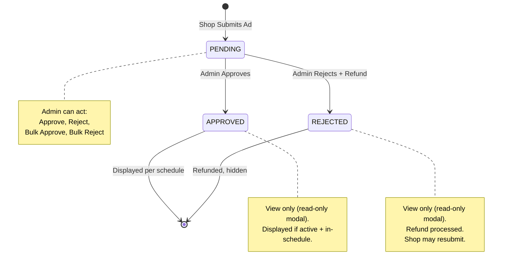

# DD_Ad_Management_Screen_01 — Module Overview

> **Doc ID:** SKM-DD-ADM-01 | **Version:** 2.0 | **Status:** Released
> **Last Updated:** 2026-10-15
> **Target Screen:** Admin Ad Management (管理者広告管理)
> **Subsystem:** Advertisement Management — Admin Ad Review, Approval, Fee Management, Analytics & Reporting
> **Function ID:** FN-ADM-001

---

## 1. Module Overview

The **Admin Ad Management Module** (管理者広告管理モジュール) provides platform administrators with full control over the advertisement lifecycle within the Cosmetics Finder platform. It covers the complete admin-side responsibilities: reviewing and approving/rejecting shop-submitted advertisements (individually or in bulk), managing advertisement package pricing and fee configurations (create, edit, deactivate, reactivate), tracking fee change history with deletion capabilities, analyzing platform-wide ad revenue breakdowns by placement and tier, and exporting ad performance, submission history, and fee history reports as CSV.

The advertisement system is a core monetization channel. Shops pay daily fees based on placement location and pricing tier. All advertisements require admin approval before display. This module defines every screen, operation, business rule, and API endpoint that the Admin interacts with to manage this subsystem.

The module spans five frontend screens within the admin section:

| Side | Frontend Screen / Route | Page File |
|------|-------------------------|-----------|
| **Admin** | `/admin/ads` (Ad List) | `frontend/src/pages/admin/ads/index.tsx` |
| **Admin** | `/admin/ads/packages` (Package & Fee Management) | `frontend/src/pages/admin/ads/packages.tsx` |
| **Admin** | `/admin/ads/fee-history` (Fee Change History) | `frontend/src/pages/admin/ads/fee-history.tsx` |
| **Admin** | `/admin/ads/analytics` (Revenue Analytics) | `frontend/src/pages/admin/ads/analytics.tsx` |
| **Admin** | `/admin/ads/export` (Export Reports) | `frontend/src/pages/admin/ads/export.tsx` |

> **Implementation Status (as of 2026-10-15):** Fully implemented. Pages are located under `frontend/src/pages/admin/ads/`. Components are under `frontend/src/features/admin/advertisement-management/components/`. Hooks are under `frontend/src/features/admin/advertisement-management/hooks/`. Types are in `frontend/src/types/admin-ad-management.ts`. Routes are registered in `frontend/src/app/routes.tsx` under `/admin/ads/*`.

---

## 2. Supported Use Cases

| ID | Use Case | Description |
| --- | --- | --- |
| UC-ADM-001 | Review Pending Advertisements | Admin views ad list with filters (status, placement, tier, shop, date range). |
| UC-ADM-002 | Approve Single Advertisement | Admin selects a pending ad, reviews content via modal, and approves. Sets `approvedBy` and `approvedAt`. |
| UC-ADM-003 | Reject Single Advertisement | Admin selects a pending ad, enters rejection reason, and rejects. Refund initiated. |
| UC-ADM-004 | Bulk Approve Advertisements | Admin selects multiple pending ads via checkboxes and approves all in batch. Max 50 per operation. |
| UC-ADM-005 | Bulk Reject Advertisements | Admin selects multiple pending ads with common reason, rejects all in batch. Max 50 per operation. |
| UC-ADM-006 | View Ad Detail | Admin views full ad details (read-only modal), including analytics, fee info, payment info. |
| UC-ADM-007 | Manage Ad Fee Settings | Admin views, creates, edits, deactivates, and reactivates fee settings per placement and tier. |
| UC-ADM-008 | View Fee Change History | Admin views historical fee changes with filters (month, placement, tier) and pagination. |
| UC-ADM-009 | Delete Fee Change History | Admin deletes previous-month fee change history records. Current-month records are protected. Max 50 per operation. |
| UC-ADM-010 | View Revenue Breakdown Analytics | Admin views financial charts and summary metrics broken down by placement and tier over custom date range. |
| UC-ADM-011 | Export Ad Performance Report | Admin exports CSV with ad metrics (impressions, clicks, CTR, revenue) per ad. Filters: placement, tier, status. |
| UC-ADM-012 | Export Shop Submission History | Admin exports CSV with all ad submissions, statuses, and outcomes per shop. Filter: shop. |
| UC-ADM-013 | Export Fee History Log | Admin exports CSV with all fee setting changes, timestamps, and reasons. Filters: placement, tier. |
| UC-ADM-014 | Create Fee Setting | Admin creates a new fee configuration for a placement and tier. Placement+tier combination must be unique. 12 total combinations possible (4 placements × 3 tiers). Default `change_reason` = "Initial fee setting". |
| UC-ADM-015 | Edit Fee Setting | Admin edits daily rate, duration, max ads, effective from, and change reason. |
| UC-ADM-016 | Deactivate Fee Setting | Admin deactivates an existing active fee setting. Existing ads unaffected (fee locking rule). |
| UC-ADM-017 | Reactivate Fee Setting | Admin reactivates a deactivated fee setting. Change reason is optional. |

---

## 3. Advertisement Approval State Machine

The admin ad management module operates on advertisements with `approvalStatus` constrained to `pending/approved/rejected` and `paymentStatus` constrained to `pending/completed/refunded`.



**Approval States (Admin View):**

| State | Description | Is Displayed | Admin Can Act |
|-------|-------------|:------------:|:-------------:|
| `pending` | Submitted by shop, awaiting admin review | No | Approve, Reject, Bulk Approve, Bulk Reject |
| `approved` | Admin approved, displayed on platform | Yes | View only (read-only modal) |
| `rejected` | Admin rejected with reason, refund processed | No | View only (read-only modal) |

**Payment States (On Rejection):**

| State | Description | Ad Active | Refundable |
|-------|-------------|:---------:|:----------:|
| `pending` | Payment initiated, not yet confirmed | No | No |
| `completed` | Payment successful | Yes (if approved) | On rejection |
| `refunded` | Refund processed after rejection | No | — |

**Fee Settings State Transitions:**

| Transition ID | Origin State | Target State | Trigger Action | Guard Conditions |
|---------------|--------------|--------------|----------------|------------------|
| TR-FEE-01 | — | Active setting | Admin creates fee setting | Valid placement, tier, dailyRate > 0, durationDays >= 1, maxAds >= 1; unique placement+tier combination |
| TR-FEE-02 | Active setting | Updated setting | Admin updates fee | Change logged to ad_fee_history; dailyRate > 0, durationDays >= 1, maxAds >= 1 |
| TR-FEE-03 | Active setting | Deactivated | Admin deactivates | Existing ads unaffected (fee locking); change_reason required |
| TR-FEE-04 | Deactivated | Active setting | Admin reactivates | Change reason optional |

---

## 4. Security & Permissions

1. **Authentication:** JWT Bearer Token required for all admin endpoints. The API client (`@/lib/api`) attaches `Authorization: Bearer <token>` automatically.
2. **Role-Based Access Control (RBAC):** All admin ad management routes are protected by `ProtectedRoute roles={['admin', 'super_admin']}`.
3. **Role Permissions:**

| Role | Can Review/Approve/Reject | Can Bulk Approve/Reject | Can Manage Fees | Can View Analytics | Can Export |
|------|:-------------------------:|:-----------------------:|:---------------:|:------------------:|:----------:|
| `buyer` | No | No | No | No | No |
| `merchant` | No | No | No | No | No |
| `admin` | Yes | Yes | Yes | Yes | Yes |
| `super_admin` | Yes | Yes | Yes | Yes | Yes |

4. **Fee Change Accountability:** Every fee change includes `changedBy` (admin ID) and `changeReason`. The fee history table displays `changedByName` and `changeReason`.
5. **Fee History Deletion Protection:** Records created in the current calendar month (UTC) are protected and cannot be deleted. Only records from previous months are deletable.
6. **Export Data Sanitization:** Exported CSV data does not include sensitive fields (password hashes, tokens, internal IDs not relevant to the report).

---

## 5. Architectural Components Involved

```
┌──────────────────────────┐      ┌─────────────────────────────────────┐
│   Admin Actor            │      │     advertisements / ad_payments    │
│ (Reviews, Approves,     ├─────►│  Reads ad records, updates status   │
│  Manages Fees, Exports)  │      │  Processes refunds on rejection     │
└──────────┬───────────────┘      └──────────────┬────────────────────┘
           │                                      │
           │  React 19 + TypeScript               │
           │  TanStack Query (server state)       │
           │  React Hook Form + Zod (forms)       │
           │                                      │
           ▼                                      ▼
┌─────────────────────────────────────────────────────────────────────┐
│                        REST API (axios)                              │
│  /admin/ads/*  |  /admin/ad-fees/*  |  /admin/ads/analytics/*       │
│  /admin/ads/export/*                                                  │
└─────────────────────────────────────────────────────────────────────┘
           │
           ▼
┌─────────────────────────────────────────────────────────────────────┐
│                     Backend Services                                 │
│  AdminAdManagementController                                         │
│  AdminAdManagementService                                            │
│  AuditService, NotificationService, ExportService                    │
└─────────────────────────────────────────────────────────────────────┘
```

**Frontend Key Modules:**

| Module | Path | Purpose |
|--------|------|---------|
| Types & Schemas | `frontend/src/types/admin-ad-management.ts` | All TypeScript interfaces, types, Zod schemas, validation codes |
| Service | `frontend/src/features/admin/advertisement-management/services/advertisement.service.ts` | API calls to backend endpoints |
| Hooks | `frontend/src/features/admin/advertisement-management/hooks/` | TanStack Query hooks for data fetching and mutations |
| Components | `frontend/src/features/admin/advertisement-management/components/` | UI components (tables, modals, forms, charts) |
| Utils | `frontend/src/features/admin/advertisement-management/utils/` | Labels (placement, tier), formatting (price, date, schedule) |

**Backend Key Modules / Services:**
- `AdminAdManagementController` — admin endpoints (`/admin/ads`, `/admin/ad-fees`, `/admin/ads/analytics`, `/admin/ads/export`).
- `AdminAdManagementService` — business logic for approval, rejection, bulk operations, fee management, analytics aggregation, export generation.
- `AuditService` — logs admin actions (2-year retention for approval/rejection, 1-year for exports).
- `NotificationService` — sends individual notifications to shop owners on approval/rejection.
- `ExportService` — generates CSV reports synchronously and streams to client.

---

## 6. API Endpoints

All endpoints use the axios client (`@/lib/api`) with JWT Bearer token authentication. Array parameters are serialized as repeated query params.

### Ad Review Endpoints

| Method & Path | Description |
| --- | --- |
| `GET /admin/ads` | List all ads with filters (`status`, `placement`, `tier`, `shop`, `dateFrom`, `dateTo`) + pagination (`page`, `limit`) |
| `GET /admin/ads/:id` | View ad detail (shop info, fee info, payment info, analytics) |
| `POST /admin/ads/:id/approve` | Approve single ad |
| `POST /admin/ads/:id/reject` | Reject single ad with `{ rejection_reason }` |
| `POST /admin/ads/bulk/approve` | Bulk approve `{ ad_ids: string[] }` (max 50) |
| `POST /admin/ads/bulk/reject` | Bulk reject `{ ad_ids: string[], rejection_reason: string }` (max 50) |

### Fee Settings Endpoints

| Method & Path | Description |
| --- | --- |
| `GET /admin/ad-fees` | List all fee settings |
| `POST /admin/ad-fees` | Create fee setting (validates uniqueness of placement+tier) |
| `PUT /admin/ad-fees/:id` | Update fee setting (logs change to ad_fee_history) |
| `PATCH /admin/ad-fees/:id/deactivate` | Deactivate fee setting |
| `PATCH /admin/ad-fees/:id/reactivate` | Reactivate fee setting |
| `GET /admin/ad-fees/history` | View fee change history with filters (`placement`, `tier`, `month`) + pagination |
| `DELETE /admin/ad-fees/history` | Delete fee change history records `{ history_ids: string[] }` (max 50) |

### Analytics & Export Endpoints

| Method & Path | Description |
| --- | --- |
| `GET /admin/ads/analytics/revenue` | Revenue breakdown analytics (`dateFrom`, `dateTo`, `placement[]`, `tier[]`) |
| `POST /admin/ads/export/ad-performance` | Export ad performance CSV (placement, tier, status filters) |
| `POST /admin/ads/export/submission-history` | Export submission history CSV (shop filter) |
| `POST /admin/ads/export/fee-history` | Export fee history CSV (placement, tier filters) |

---

## 7. Database Tables Involved

| Table | Purpose | Key Columns / Usage |
| --- | --- | --- |
| `advertisements` | Core ad records, approval/payment state, schedule | `id`, `shop_id`, `title`, `content`, `announcement_message`, `image_url`, `sku`, `link_url`, `is_active`, `approval_status`, `payment_status`, `payment_amount`, `approved_by`, `approved_at`, `rejection_reason`, `starts_at`, `expires_at`, `week_number`, `created_at` |
| `ad_payments` | Payment transaction ledger + refunds | `id`, `ad_id`, `amount`, `payment_status` (`pending/completed/refunded`), `refund_amount`, `refund_reason`, `refunded_at`, `paid_at` |
| `ad_fee_settings` | Admin-created package catalog (placement x tier) | `id`, `placement`, `tier`, `daily_rate`, `duration_days`, `max_ads`, `is_active`, `created_at`, `updated_at` |
| `ad_fee_history` | Fee change audit trail | `id`, `ad_fee_setting_id`, `placement`, `tier`, `old_daily_rate`, `new_daily_rate`, `old_duration_days`, `new_duration_days`, `old_max_ads`, `new_max_ads`, `changed_by`, `changed_by_name`, `change_reason`, `effective_from`, `created_at` |
| `shops` | Merchant store info (joined for ad list) | `id`, `name` |
| `users` | Admin identity for `approved_by` / `changed_by` | `id`, `name` |
| `notifications` | Ad status notifications + export ready | `id`, `user_id`, `type`, `message` |
| `audit_logs` | All admin action logging (append-only) | `id`, `admin_id`, `event_type`, `entity_type`, `entity_id`, `details` |

**Constraints:** `approval_status` check (`pending/approved/rejected`), `payment_status` check (`pending/completed/refunded`), unique active fee per `placement+tier` combination.

---

## 8. Business Rules Summary

| Rule Cluster | Rule / Constraint |
| --- | --- |
| **Ad Review & Approval** | Only `admin` and `super_admin` roles can approve/reject. Rejection requires reason (max 1000 chars, VAL-ADM-001/002). Approval metadata (`approvedBy`, `approvedAt`) recorded. Refund on rejection. Only `pending` ads can be approved/rejected. |
| **Bulk Operations** | Max 50 ads per bulk operation (VAL-ADM-010/011). All selected ads must be `pending` (checkboxes disabled for non-pending). Bulk reject requires common reason. Individual notifications per shop owner. |
| **Ad Display** | Only `approved` + `is_active=true` + in-schedule ads displayed. Priority: Premium > Standard > Basic. |
| **Fee Management** | All fee changes logged to `ad_fee_history` with before/after values. Unique active fee per placement+tier. Daily rate, duration, max_ads > 0. Fee creation/update/deactivation logged to audit. Deactivation only on active settings. Reactivation makes package available again. |
| **Fee History Deletion** | Records from current calendar month (UTC) are protected and cannot be deleted. Max 50 records per deletion. |
| **Revenue Analytics** | Date range required. Revenue from `completed` payments on `approved` ads. Breakdown by placement and tier. |
| **Export** | CSV format only. Date range required. Filters are optional (placement, tier, status, shop). Export triggers immediate browser download. |
| **Security** | All endpoints require `admin` or `super_admin` role. Audit logs append-only. Fee changes include `changedBy` and `changeReason`. Export data sanitized. |
| **Fee Locking** | Once a Merchant has purchased a package, the fee is locked. Later fee setting changes do not affect existing advertisement paid amounts. |

---

## 9. External Dependencies

| Dependency | Reason |
| --- | --- |
| **JWT** | Authentication/signed access and role enforcement. |
| **File storage** | Export CSV generation and download. |
| **Payment System** | Refund processing on ad rejection (single and batch). |
| **Audit service** | Logs admin actions (2-year retention for approval/rejection, 1-year for exports). |
| **Notification service** | Sends individual notifications to shop owners via WebSocket and in-app notification center. |

---

## 10. Configurable Items

| Definition Key | Default Value | Description |
|----------------|---------------|-------------|
| `AD_BULK_MAX_SIZE` | `50` | Maximum ads per bulk operation (enforced in frontend and backend) |
| `AD_ANALYTICS_MAX_RANGE_DAYS` | `365` | Maximum date range for analytics queries |
| `AD_SLIDER_MAX` | `5` | Maximum ads per slider rotation |
| `AD_SLIDER_INTERVAL` | `5000` | Slider auto-rotation interval in milliseconds |
| `MAX_FEE_HISTORY_DELETE` | `50` | Maximum fee history records per bulk delete |

**Fee settings** are managed dynamically via the `ad_fee_settings` database table and can be updated by admins through the Package & Fee Management screen. There are 12 possible combinations (4 placements x 3 tiers).

---

## 11. Screen Transitions

| Source | Target | Trigger |
|--------|--------|---------|
| Admin dashboard / sidebar | `/admin/ads` | Click "Advertisement Management" in sidebar |
| `/admin/ads` | Ad Review Modal | Click "Review" (Pencil icon) on ad row |
| `/admin/ads` | Ad View Modal (read-only) | Click "View" (Eye icon) on ad row |
| `/admin/ads` | Bulk Approve Modal | Click "Approve All" with ads selected |
| `/admin/ads` | Bulk Reject Modal | Click "Reject All" with ads selected |
| `/admin/ads` | `/admin/ads/packages` | Click "Manage Packages" |
| `/admin/ads` | `/admin/ads/analytics` | Click "Revenue Analytics" |
| `/admin/ads` | `/admin/ads/export` | Click "Export" |
| `/admin/ads` | `/admin/ads?highlightAdId=:id&status=pending` | Click AD_SUBMITTED notification (deep link, highlights row for 3 seconds) |
| `/admin/ads/packages` | Edit Fee Modal | Click "Edit" (Pencil icon) on fee setting |
| `/admin/ads/packages` | Create Fee Modal | Click "Create Fee Setting" |
| `/admin/ads/packages` | Deactivate Fee Modal | Click "Deactivate" (Ban icon) on fee setting |
| `/admin/ads/packages` | Reactivate Fee Modal | Click "Reactivate" (RotateCcw icon) on fee setting |
| `/admin/ads/packages` | `/admin/ads/fee-history` | Click "View History" |
| `/admin/ads/fee-history` | Delete Fee History Modal | Click "Delete" (Trash2 icon) or "Delete Selected" |
| `/admin/ads/fee-history` | `/admin/ads/packages` | Click "Back to Packages" |
| `/admin/ads/analytics` | `/admin/ads` | Click "Back to Ads" |
| `/admin/ads/export` | `/admin/ads` | Click "Back to Ads" |

---

## 12. Cross-References

| Related Document | Purpose |
| ----------------- | -------- |
| [DD_Ad_Management_Screen_02_FRONTEND_Page.md](./DD_Ad_Management_Screen_02_FRONTEND_Page.md) | Frontend page design |
| [機能設計書_Ad_Management_Screen](../機能設計書_Ad_Management_Screen.md) | Full functional specification |
| [画面項目設計書_Ad_Management_Screen](../画面項目設計書_Ad_Management_Screen.md) | Screen items specification |
| [要件定義書](../../../../docs/core-work/要件定義書_REQUIREMENT_SPEC.md) | Requirements (B-ADM-003~015) |
| [データベース設計書](../../../../docs/core-work/データベース設計書_DATABASE_SPEC.md) | Database schema |
| [開発ルール](../../../../docs/core-work/開発ルール_DEVELOPMENT_RULES.md) | Development rules, REST conventions, audit retention |
