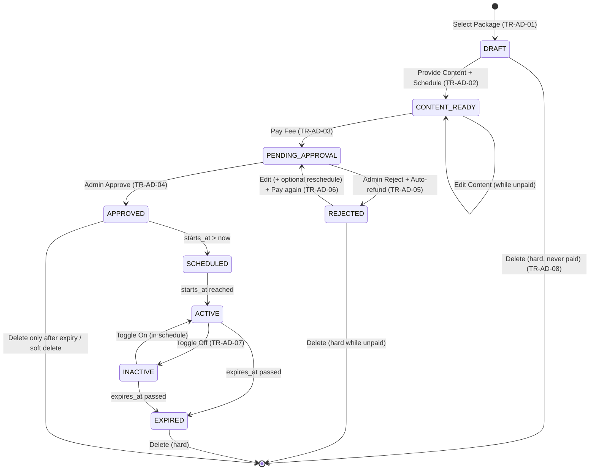

# DD_Advertisement_Management_01 — Module Overview

> **Doc ID:** SKM-DD-AD-01 | **Version:** 2.0 | **Status:** Released
> **Last Updated:** 2026-10-16
> **Target Screen:** Advertisement Management (広告管理)
> **Subsystem:** Advertisement — Shop Advertisement Management
> **Function ID:** FN-AD-001

---

## Revision History

| Version | Date | Author | Summary |
|---------|------|--------|---------|
| 1.0 | 2026-08-26 | Software Architect | Initial module overview. |
| 2.0 | 2026-10-16 | Engineering | Rewritten against the current source. Corrected placements, endpoints, DTO fields (product-image selection instead of image upload; `sku` instead of `linkUrl`), removed the non-implemented weekly limit, and documented the admin review / bulk / fee-history / analytics / CSV-export functionality that now exists. |

---

## 1. Module Overview

The **Advertisement Management Module** (広告管理モジュール) manages the full lifecycle of shop advertisements within the Cosmetics Finder marketplace through a **6-step flow**: **1 · Select Package → 2 · Provide Content + Schedule → 3 · Pay Fee → 4 · Admin Review → 5 · Approved → 6 · Displayed**.

Merchants browse admin-created advertisement packages (defined in `ad_fee_settings`), select a package to create a draft advertisement (`approval_status = pending`, `payment_status = pending`), provide their ad content (`title`, `content`, `announcementMessage`), pick the banner image from **one of their own product images** (the stored path is validated against the merchant's catalogue and its `sku` is snapshotted), set a start date (at least 3 days in the future), pay the advertising fee (`daily_rate × duration_days`), and the paid ad enters the admin review queue. Admins approve or reject advertisements (a rejection triggers an automatic refund). Only paid, approved, in-schedule, active advertisements are exposed to the public storefront for banner rendering. Rejected ads can be edited and resubmitted by the merchant.

The module spans two backend module groups and two primary screens:

| Side | Backend Module Path | Frontend Screen / Route |
|------|---------------------|-------------------------|
| **Merchant** | `backend/src/modules/merchant/advertisements/` | `/merchant/advertisements` (`frontend/src/pages/merchant/Advertisements.tsx`) |
| **Admin** | `backend/src/modules/admin/advertisement-management/` | `/admin/ads` (`frontend/src/pages/admin/ads/index.tsx`) |

> **Implementation Status (as of 2026-10-16):** Both sides are **fully implemented**. The merchant controller (`AdvertisementsController`) and service (`AdvertisementsService`) implement package browsing, package selection, content upload, payment, own-ad listing, content edit, delete and toggle. The admin module (`AdminAdManagementController`, `AdminAdManagementService`, `AdminAdExportService`) implements the review list, ad detail, single and bulk approve/reject, fee-setting CRUD + deactivate/reactivate, fee history (list + delete), revenue analytics, and CSV report exports. The only unused artefacts in the merchant module are the intentionally empty `dto/create-advertisement.dto.ts`, `dto/select-package.dto.ts`, and `README.md`.
>
> **Placement enum values are case-sensitive and include a camelCase segment.** The canonical values are `search_page_banner`, `recommendation_page_banner`, `checkout_page_banner`, `productDetail_page_banner` (see `backend/src/modules/admin/advertisement-management/enums.ts`).

---

## 2. Supported Use Cases

| ID | Use Case | Description |
| --- | --- | --- |
| UC-AD-001 | Select Advertisement Package | Merchant selects an active admin-created package; a draft advertisement is created (`approval_status = pending`, `payment_status = pending`, `is_active = true`, empty content, no schedule). Requires an approved shop. |
| UC-AD-002 | Provide Ad Content & Schedule | Merchant submits `title`, `content`, a product image (`imageUrl` — must be one of the merchant's own product images), `announcementMessage`, and a `startsAt` at least 3 days in the future. `expiresAt` is derived as `startsAt + package durationDays`. Ad remains `pending`/`pending`. |
| UC-AD-003 | Pay Advertising Fee | Fee (`daily_rate × duration_days`) is recorded in `ad_payments`; `payment_status = completed`; the ad enters the admin review queue and admins are notified (`AD_SUBMITTED`). |
| UC-AD-004 | Manage Own Advertisements | Merchant views a paginated, filterable list of their own advertisements (`GET /ads/my-ads`), including status statistics. |
| UC-AD-005 | Edit Advertisement / Resubmit | Merchant edits content fields for ads that are editable (rejected, or pending + unpaid). A rejected ad may also re-pick its start date before resubmitting. |
| UC-AD-006 | Delete Advertisement | Merchant deletes an ad. Drafts and unpaid rejected ads (never paid) and expired ads are **hard-deleted**; paid non-expired ads are **soft-deleted** (`is_active = false`). Active approved ads cannot be deleted. |
| UC-AD-007 | Toggle Advertisement Active/Inactive | Merchant toggles `is_active` on approved, paid advertisements (the package may be inactive). |
| UC-AD-008 | Display Active Advertisements | Public endpoint returns paid, approved, active, in-schedule ads for storefront banner rendering (per-placement). |
| UC-AD-009 | Browse Advertisement Packages | Merchant (or admin) browses the admin-created package catalog. |
| UC-AD-010 | Review Advertisements (Admin) | Admin lists all submitted ads with filters (status, placement, tier, shop, date range) and views a single ad's detail (fee + payment + analytics placeholder). |
| UC-AD-011 | Approve Advertisement | Admin sets `approval_status = approved`, `approved_by`, `approved_at`; the merchant is notified. |
| UC-AD-012 | Reject Advertisement | Admin sets `approval_status = rejected` and `rejection_reason`; all completed payments for the ad are refunded (`ad_payments` → `refunded`, `advertisements.payment_status` → `refunded`). The merchant is notified. |
| UC-AD-013 | Bulk Approve | Admin approves up to 50 pending ads in one request. |
| UC-AD-014 | Bulk Reject | Admin rejects up to 50 pending ads with one shared reason; completed payments are refunded per ad. |
| UC-AD-015 | Manage Ad Packages (Fee Settings) | Admin creates, updates, deactivates and reactivates `ad_fee_settings`. Every change is written to `ad_fee_history` and audited. |
| UC-AD-016 | View / Delete Fee History | Admin lists `ad_fee_history` (filter by placement, tier, month) and deletes records from **previous** calendar months (current-month records are protected). |
| UC-AD-017 | Revenue Analytics | Admin views revenue by placement/tier and a daily trend for a date range (≤ 365 days). |
| UC-AD-018 | Export CSV Reports | Admin exports ad-performance, submission-history and fee-history reports as CSV. |

Covered requirements: **M-AD-001** through **M-AD-011**. **M-AD-012** (per-merchant max 2 active ads) is not implemented. **M-AD-013/014** (fixed 7–30 day duration) are superseded by package-defined durations in `ad_fee_settings` (admin-entered, ≥ 1 day).

---

## 3. Advertisement State Machine

The advertisement lifecycle uses an `approval_status` column (`pending/approved/rejected`), a `payment_status` column (`pending/completed/refunded`), and `is_active`. Content state is tracked by the presence of content fields; display state is derived from the schedule. These enum values are enforced **only in application code** — the Prisma schema and migrations do **not** define `CHECK` constraints for them.



**Display States:**

| State | Description | Visible to Buyers | Can Edit | Can Delete | Toggle |
|-------|-------------|:-----------------:|:--------:|:----------:|:------:|
| `DRAFT` | Package selected; empty content; `payment_status = pending` | ✗ | ✓ | ✓ (hard) | — |
| `CONTENT_READY` | Content + schedule present; `payment_status = pending` | ✗ | ✓ | ✓ (hard) | — |
| `PENDING_APPROVAL` | `approval_status = pending`, `payment_status = completed`; awaiting admin review | ✗ | ✗ | ✗ | — |
| `APPROVED` | `approval_status = approved`, `payment_status = completed` | depends on schedule + `is_active` | ✗ | ✗ | ✓ |
| `REJECTED` | `approval_status = rejected` (any completed payment refunded) | ✗ | ✓ (resubmit) | ✓ (hard if unpaid, soft if paid) | — |
| `SCHEDULED` | approved, `is_active = true`, `starts_at > now` | ✗ | — | — | ✓ |
| `ACTIVE` | approved, `is_active = true`, `starts_at <= now <= expires_at` | ✓ | — | — | ✓ |
| `INACTIVE` | approved, `is_active = false` (merchant-controlled) | ✗ | — | ✓ | ✓ |
| `EXPIRED` | `expires_at < now` | ✗ | ✗ | ✓ (hard) | — |

> **Approval Status Enum:** `pending → approved`, `pending → rejected`, `rejected → pending` (on resubmit). Rejection is only allowed while `pending` (`assertPending`).
>
> **Payment Status Enum:** `pending → completed`, `completed → refunded`, `refunded → pending` (effectively, on resubmit a new `completed` payment row is added and the ad is set back to `pending`/`completed`). `failed` is **not** a valid value anywhere.

---

## 4. Security & Permissions

1. **Authentication**: JWT Bearer Token (`Authorization: Bearer <token>`) required for all merchant and admin operations. The active-ads display endpoint (`GET /ads/active`) is `@Public()` (no auth).
2. **Role-Based Access Control (RBAC):**
   - `merchant`: browse packages, select a package, provide content, pay, list/edit/delete/toggle own ads, resubmit rejected. Own-shop scope only.
   - `admin`: review ads (list + detail), approve/reject (single and bulk), full fee-setting and fee-history management, revenue analytics, CSV exports. Admin has **no** merchant write endpoints (the merchant write routes are `@Roles('merchant')` only).
   - `buyer` / anonymous: view active ads via the public endpoint only.
3. **Shop approval**: `selectPackage` verifies `shop.isApproved === true`; otherwise throws `ForbiddenException('SHOP_NOT_APPROVED')`. Other merchant mutations resolve the shop through `getOwnedAd` (which throws `NotFoundException('Shop not found')` when the merchant has no shop).
4. **Ownership Enforcement:** Merchant endpoints resolve the shop with `shop.findUnique({ where: { userId } })` and compare `advertisement.shopId`; cross-ownership returns `ForbiddenException('You do not have permission to manage this advertisement')`. Guard chain:

```typescript
@Controller('ads')
@UseGuards(JwtAuthGuard, RolesGuard)
export class AdvertisementsController { ... }        // per-route @Roles('merchant') / @Roles('merchant','admin') / @Public()

@Controller('admin')
@UseGuards(JwtAuthGuard, RolesGuard)
@Roles('admin')
export class AdminAdManagementController { ... }
```

---

## 5. Architectural Components Involved

```
┌────────────────────────┐
│  Merchant Actor        │  Select package / Provide content / Pay fee / Manage / Resubmit
└────────────┬───────────┘
             ▼
┌─────────────────────────────────────────────────────────────┐
│                MERCHANT MODULE                               │
│  backend/src/modules/merchant/advertisements/                │
│  AdvertisementsController → AdvertisementsService            │
└───────────────┬─────────────────────────────────────────────┘
                ▼
┌───────────────────────────────┐   ┌────────────────────────────────────────────┐
│  Data Layer (Prisma + PG)     │   │              ADMIN MODULE                   │
│  advertisements               │   │  backend/src/modules/admin/                 │
│  ad_fee_settings              │   │  advertisement-management/                   │
│  ad_payments                  │   │  AdminAdManagementController                 │
│  ad_fee_history               │   │    → AdminAdManagementService                │
│  shops / merchants / users    │   │    → AdminAdExportService (CSV)              │
│  products (image source)      │   └───────────────────┬────────────────────────┘
└───────────────────────────────┘                       │
                ▼                                       ▼
┌───────────────────────────────┐   ┌──────────────────────────────┐
│  Redis Cache                  │   │  Audit Log / Notifications  │
│  cache:ads:active  (TTL 5min) │   │  AD_SELECTED, AD_PAID, ...   │
│  cache:ads:packages (TTL 10m) │   │  FEE_CREATED, FEE_UPDATED ...│
└───────────────────────────────┘   └─────────────────────────────┘
                ▼
             ┌─────────────────────────────┐
             │ STOREFRONT (public) — Buyer │
             │  GET /ads/active → Banners  │
             └─────────────────────────────┘
```

**Key Modules / Services:**
- `AdvertisementsController` (merchant) — `/ads/*` routes.
- `AdminAdManagementController` (admin) — `/admin/ads*` and `/admin/ad-fees*` routes.
- `AdvertisementsService` (merchant) — package catalog, package selection, content/schedule resolution, product-image resolution, payment, listing, edit, delete, toggle, active-ads cache.
- `AdminAdManagementService` (admin) — review, approval/rejection (incl. refunds), fee settings, fee history, revenue analytics.
- `AdminAdExportService` (admin) — CSV report generation.
- Redis cache service — `cache:ads:active` (5 min TTL), `cache:ads:packages` (10 min TTL).
- Audit service — `auditLog` rows written by both services.

---

## 6. API Endpoints

Global prefix `/api/v1`. See [DD_Advertisement_Management_03_API_ENDPOINTS.md](./DD_Advertisement_Management_03_API_ENDPOINTS.md) for full contracts.

### Merchant / public (`/ads/*`)

| Method & Path | Access | Description | Caching |
| --- | --- | --- | --- |
| `GET /ads/active` | Public | Approved, paid, active, in-schedule ads for banners | `cache:ads:active` (5 min) |
| `GET /ads/packages` | Merchant/Admin | Browse active package catalog | `cache:ads:packages` (10 min) |
| `POST /ads/packages/:feeSettingId/select` | Merchant | Select package → creates draft ad | — |
| `GET /ads/my-ads` | Merchant | Paginated own ad list with filters | — |
| `PATCH /ads/:id/content` | Merchant | Provide content + set schedule | invalidates `cache:ads:active` |
| `POST /ads/:id/pay` | Merchant | Pay advertising fee | invalidates `cache:ads:active` |
| `PATCH /ads/:id` | Merchant | Edit content (and optionally reschedule) | invalidates `cache:ads:active` |
| `DELETE /ads/:id` | Merchant | Delete ad (hard for drafts/expired, else soft) | invalidates `cache:ads:active` |
| `PATCH /ads/:id/toggle` | Merchant | Toggle active/inactive | invalidates `cache:ads:active` |

> The merchant controller manually wraps write responses in `{ data }` (the global interceptor wraps again); `GET /ads/my-ads` and `DELETE /ads/:id` return their payloads un-wrapped.

### Admin (`/admin/*`, `@Roles('admin')`)

| Method & Path | Description | Caching |
| --- | --- | --- |
| `GET /admin/ads` | List submitted ads (filters: status, placement, tier, shop, date range) | — |
| `GET /admin/ads/:id` | Ad detail (fee + latest payment + analytics placeholder) | — |
| `POST /admin/ads/:id/approve` | Approve one pending ad | invalidates `cache:ads:active` |
| `POST /admin/ads/:id/reject` | Reject one pending ad + auto-refund | invalidates `cache:ads:active` |
| `POST /admin/ads/bulk/approve` | Bulk approve (≤ 50) | invalidates `cache:ads:active` |
| `POST /admin/ads/bulk/reject` | Bulk reject (≤ 50) + auto-refund | invalidates `cache:ads:active` |
| `GET /admin/ad-fees` | List all fee settings | — |
| `POST /admin/ad-fees` | Create a package (or reactivate an inactive one) | invalidates `cache:ads:packages` |
| `PUT /admin/ad-fees/:id` | Update rate/duration/maxAds | invalidates `cache:ads:packages` |
| `PATCH /admin/ad-fees/:id/deactivate` | Deactivate a package | invalidates `cache:ads:packages` |
| `PATCH /admin/ad-fees/:id/reactivate` | Reactivate a package | invalidates `cache:ads:packages` |
| `GET /admin/ad-fees/history` | Paginated fee history | — |
| `DELETE /admin/ad-fees/history/:id` | Delete one fee-history record | — |
| `DELETE /admin/ad-fees/history` | Bulk delete fee-history records (body `history_ids`) | — |
| `GET /admin/ads/analytics/revenue` | Revenue analytics for a date range | — |
| `POST /admin/ads/export/ad-performance` | CSV export (ad performance) | — |
| `POST /admin/ads/export/submission-history` | CSV export (submission history) | — |
| `POST /admin/ads/export/fee-history` | CSV export (fee history) | — |

---

## 7. Database Tables Involved

| Table | Purpose | Key Columns / Usage |
| --- | --- | --- |
| `advertisements` | Core ad records | `id`, `shop_id`, `fee_setting_id` (FK → `ad_fee_settings`, optional), `title`, `content`, `announcement_message`, `image_url`, `sku`, `is_active`, `approval_status`, `payment_status`, `payment_amount`, `payment_reference`, `approved_by`, `approved_at`, `rejection_reason`, `week_number`, `starts_at`, `expires_at`, `created_at` |
| `ad_fee_settings` | Admin-created package catalog (placement × tier) | `id`, `placement`, `tier`, `daily_rate`, `duration_days`, `max_ads`, `is_active`, `created_at`, `updated_at`; unique (`placement`, `tier`) |
| `ad_payments` | Payment/refund ledger | `id`, `ad_id`, `merchant_id` (→ `merchants.id`), `amount`, `payment_method`, `payment_status`, `transaction_id`, `paid_at`, `refund_amount`, `refund_reason`, `refunded_at` |
| `ad_fee_history` | Fee-setting change log | `id`, `ad_fee_setting_id`, `old_daily_rate`, `new_daily_rate`, `old_duration_days`, `new_duration_days`, `old_max_ads`, `new_max_ads`, `changed_by` (→ `users.id`), `change_reason`, `effective_from`, `created_at` |
| `products` | Source of valid banner images | `images[]` contains the chosen `image_url`; `sku` snapshotted onto the ad |
| `shops` | Merchant store + approval check | `id`, `name`, `user_id`, `is_approved` |
| `merchants` | Merchant profile | `id`, `user_id` |
| `users` | Admin identity for `approved_by` / `changed_by` / audit | `id`, `role_code`, `name` |

> **No `CHECK` constraints exist** for the status/date columns in the Prisma schema or migrations. The `chk_advertisements_*` / `chk_ad_fee_settings_*` names referenced in earlier document revisions are **not** present in the database; ordering (`expires_at > starts_at`) and enum membership are enforced in application code only.

---

## 8. Business Rules Summary

| Rule Cluster | Rule / Constraint (as implemented) |
| --- | --- |
| **Package Selection / Creation** | Draft created with empty `title`/`announcement_message`, `pending`/`pending`, `is_active = true`, null schedule. Shop must be approved. Package must be active and have an `effective_from` in the past. |
| **Content** | `title` required, ≤ 200 chars. `content` optional, ≤ **100** chars (rendered in a 2-line clamp). `announcementMessage` required, ≤ 500 chars. `imageUrl` required on upload, ≤ 2048 chars, and must exactly match one of the merchant's own product images (else `400 Advertisement image must be selected from your products`). No file upload / multipart. |
| **Schedule** | `startsAt` required (`@IsDateString`), must be ≥ **3 days** from today (UTC day granularity). `expiresAt = startsAt + duration_days` (server-derived). `expiresAt > startsAt` else `409 AD_SCHEDULE_INVALID`. `week_number` derived (ISO week) from `startsAt` at payment. |
| **Status** | Only `is_active = true` + `approval_status = approved` + `payment_status = completed` + in-schedule ads are served to buyers. |
| **Ownership** | Merchant manages own-shop ads only; admin reviews all ads; buyers read-only. |
| **Approval Workflow** | Payment required before review; rejection requires a reason and auto-refunds; resubmission allowed with fresh payment. |
| **Payment** | Payment after content+schedule; fee = `daily_rate × duration_days` snapshotted to `payment_amount`; recorded in `ad_payments` (method `stubbed`, status `completed`). |
| **Delete** | Hard delete for never-paid drafts/rejected and for expired ads; soft delete (`is_active=false`) for paid non-expired ads. Active approved ads cannot be deleted. |
| **Toggle** | Only approved + completed ads; `fee_setting` is optional (ads whose package was deactivated remain toggleable). |
| **Cache** | 5-min active cache; 10-min packages cache; invalidated on the mutations listed in §6. |
| **Package & Duration** | Active package required with `effective_from <= now`; duration fixed by the package for the selected ad (admin-entered, ≥ 1 in the DTO/UI; seeded 7/15/30). Rate snapshot stored at payment. Multiple merchants may buy the same package. |

> **Weekly limit:** The earlier "max 5 ads/week per merchant" rule is **not implemented**. `week_number` is computed and stored, but no code counts a merchant's weekly ads or blocks approval. Admin approval has no weekly-limit guard.

---

## 9. External Dependencies

| Dependency | Reason |
| --- | --- |
| **Redis 7+** | Active-ads cache (`cache:ads:active`, 5 min TTL) and package catalog cache (`cache:ads:packages`, 10 min TTL). |
| **JWT** | Authentication/signed access and role enforcement. |
| **Product image store** | Banner images are **not** uploaded by the ad module; the merchant selects an existing product image, whose stored path/`sku` is referenced. |
| **Payment system (stubbed)** | Charges `daily_rate × duration_days`; returns a `TXN-<uuid>` reference recorded in `ad_payments`. |
| **Notification service** | `AD_SUBMITTED` to admins on payment; `AD_APPROVED` / `AD_REJECTED` / `NEW_ADS_PACKAGE` / `ADS_PACKAGE_UPDATED` to merchants. Best-effort. |
| **Audit log** | `auditLog` rows for merchant and admin actions (see DD_05 §9). |

---

## 10. Screen Transitions

| Source | Target | Condition |
|--------|--------|-----------|
| Merchant dashboard | `/merchant/advertisements` | Click "Advertisements" menu |
| Admin dashboard | `/admin/ads` | Click "Advertisement Management" menu |
| `/admin/ads` | `/admin/ads/packages` | Open Packages tab |
| `/admin/ads` | `/admin/ads/fee-history` | Open Fee History tab |
| `/admin/ads` | `/admin/ads/analytics` | Open Analytics tab |
| `/admin/ads` | `/admin/ads/export` | Open Export tab |
| `/merchant/advertisements` | Package Selection Dialog | Click "Select" on a package card |
| Package Selection Dialog | Upload Content Dialog | Click "Confirm Select" |
| Upload Content Dialog | `/merchant/advertisements` | Click "Save & Continue" (Pay Fee becomes available) |
| Pay Fee on ad card | Payment Confirmation Dialog | Click "Pay Fee" |
| Edit button on ad card | Edit Ad Content Dialog | Click "Edit" / "Resubmit" |
| Admin review list | Approve/Reject (modal) | Click "Approve" / "Reject" |
| Admin review list | Bulk approve/reject (modal) | Select rows → bulk action |
| Ad banner (storefront) | product detail (via `sku`) | Buyer clicks an active banner |
| Any ad page | `/login` | 401 Unauthorized |
| Any ad page | refresh list | 404 Advertisement not found |

---

## 11. Input Validation Summary

### Merchant DTOs

| Endpoint | Field | Type / Max | Required | Validation |
|----------|-------|-----------|:--------:|------------|
| `POST /ads/packages/:feeSettingId/select` | `feeSettingId` | UUID (path) | Yes | `ParseUUIDPipe`; service resolves an active package with `effective_from <= now` (`404 AD_PACKAGE_INVALID`) |
| `PATCH /ads/:id/content` | `title` | String(200) | Yes | `@IsString` `@IsNotEmpty` `@MaxLength(200)` |
| `PATCH /ads/:id/content` | `content` | String(100) | No | `@MaxLength(100)` — message "Content must not exceed 100 characters" |
| `PATCH /ads/:id/content` | `imageUrl` | String(2048) | Yes | `@IsString` `@IsNotEmpty` `@MaxLength(2048)`; must be one of the merchant's product images |
| `PATCH /ads/:id/content` | `announcementMessage` | String(500) | Yes | `@IsString` `@IsNotEmpty` `@MaxLength(500)` |
| `PATCH /ads/:id/content` | `startsAt` | ISO date | Yes | `@IsDateString`; ≥ 3 days from today |
| `POST /ads/:id/pay` | `paymentReference` | String(100) | No | `@IsOptional` `@IsString` `@MaxLength(100)` |
| `PATCH /ads/:id` | `title` | String(200) | Yes | `@IsString` `@IsNotEmpty` `@MaxLength(200)` |
| `PATCH /ads/:id` | `content` | String(100) | No | `@MaxLength(100)` |
| `PATCH /ads/:id` | `imageUrl` | String(2048) | No | Optional (omitting keeps current); if present, must be one of the merchant's product images |
| `PATCH /ads/:id` | `announcementMessage` | String(500) | Yes | `@IsString` `@IsNotEmpty` `@MaxLength(500)` |
| `PATCH /ads/:id` | `startsAt` | ISO date | No | Optional reschedule; same ≥ 3 days rule |
| `PATCH /ads/:id/toggle` | `isActive` | boolean | Yes | `@IsBoolean` |
| `GET /ads/my-ads` | `page` | int ≥ 1 | No | default 1 |
| `GET /ads/my-ads` | `limit` | int 1–100 | No | default 20 |
| `GET /ads/my-ads` | `status` | enum | No | `active` \| `inactive` \| `expired` |
| `GET /ads/my-ads` | `approvalStatus` | enum | No | `pending` \| `approved` \| `rejected` |
| `GET /ads/my-ads` | `search` | String(100) | No | title match (case-insensitive) |

### Admin DTOs

| Endpoint | Field | Validation |
|----------|-------|------------|
| `GET /admin/ads` | `status` | `pending` \| `approved` \| `rejected` |
| `GET /admin/ads` | `placement` | one of the 4 placement values |
| `GET /admin/ads` | `tier` | `basic` \| `standard` \| `premium` |
| `GET /admin/ads` | `shop` | string ≤ 255 (name contains) |
| `GET /admin/ads` | `dateFrom`/`dateTo` | ISO date strings (on `created_at`) |
| `GET /admin/ads` | `page` / `limit` | page ≥ 1 (def 1); limit 1–100 (def 20) |
| `POST /admin/ads/:id/reject` | `rejection_reason` | required, ≤ 1000 chars |
| `POST /admin/ads/bulk/approve` | `ad_ids` | UUID array, 1–50 |
| `POST /admin/ads/bulk/reject` | `ad_ids` | UUID array, 1–50 |
| `POST /admin/ads/bulk/reject` | `rejection_reason` | required, ≤ 1000 chars |
| `POST /admin/ad-fees` | `placement` | one of the 4 placement values |
| `POST /admin/ad-fees` | `tier` | `basic` \| `standard` \| `premium` |
| `POST /admin/ad-fees` | `daily_rate` | `@IsNumber` `@Min(0.01)` |
| `POST /admin/ad-fees` | `duration_days` | `@IsInt` `@Min(1)` |
| `POST /admin/ad-fees` | `max_ads` | `@IsInt` `@Min(1)` |
| `POST /admin/ad-fees` | `effective_from` | required date |
| `POST /admin/ad-fees` | `change_reason` | required, ≤ 1000 chars |
| `PUT /admin/ad-fees/:id` | `daily_rate` / `duration_days` / `max_ads` | same rules as create |
| `PUT /admin/ad-fees/:id` | `effective_from` / `change_reason` | required |
| `PATCH /admin/ad-fees/:id/deactivate` | `change_reason` | required, ≤ 1000 chars |
| `PATCH /admin/ad-fees/:id/reactivate` | `change_reason` | optional, ≤ 1000 chars |
| `GET /admin/ad-fees/history` | `placement` / `tier` / `month` (`YYYY-MM`) / `page` / `limit` | as per `AdminAdFeeHistoryQueryDto` |
| `DELETE /admin/ad-fees/history` | `history_ids` | UUID array, 1–50 |
| `GET /admin/ads/analytics/revenue` | `dateFrom` / `dateTo` | required ISO dates; range ≤ 365 days (service) |
| `GET /admin/ads/analytics/revenue` | `placement[]` / `tier[]` | optional arrays |
| `POST /admin/ads/export/*` | `dateFrom` / `dateTo` / `format='csv'` | required; plus report-specific filters |

---

## 12. Cross-References

| Related Document | Purpose |
| ----------------- | -------- |
| [DD_Advertisement_Management_02_FRONTEND_Page.md](./DD_Advertisement_Management_02_FRONTEND_Page.md) | Frontend page design |
| [DD_Advertisement_Management_03_API_ENDPOINTS.md](./DD_Advertisement_Management_03_API_ENDPOINTS.md) | API endpoint contracts |
| [DD_Advertisement_Management_04_DTOS_AND_TYPES.md](./DD_Advertisement_Management_04_DTOS_AND_TYPES.md) | DTOs and TypeScript types |
| [DD_Advertisement_Management_05_BUSINESS_LOGIC.md](./DD_Advertisement_Management_05_BUSINESS_LOGIC.md) | Service business logic |
| [DD_Advertisement_Management_06_TEST_SPEC.md](./DD_Advertisement_Management_06_TEST_SPEC.md) | Test specification |
| [機能設計書_Advertisement_Management](../機能設計書_Advertisement_Management.md) | Full functional specification |
| [画面項目設計書_Advertisement_Management](../画面項目設計書_Advertisement_Management.md) | Screen items specification |
| [要件定義書](../../../../docs/core-work/要件定義書_REQUIREMENT_SPEC.md) | Requirements (M-AD-001~014) |
| [データベース設計書](../../../../docs/core-work/データベース設計書_DATABASE_SPEC.md) | Database schema (`advertisements`, `ad_fee_settings`, `ad_payments`, `ad_fee_history`) |
| [開発ルール](../../../../docs/core-work/開発ルール_DEVELOPMENT_RULES.md) | Development rules, REST conventions, audit retention |
