# DD_AUDIT_01 — Module Overview

> **Doc ID:** SKM-DD-AUDIT-01 | **Version:** 1.2 | **Status:** Draft  
> **Last Updated:** 2026-10-21

---

## 1. Module Overview

The **Audit Log module** provides the administrator-only audit trail for Cosmetics Finder. It supports read-only viewing, combined filtering, full-detail inspection, streamed CSV export, and carefully constrained manual deletion of old audit records. The module records platform activity; it does not modify audit events during viewing, filtering, refreshing, or exporting.

## 2. Supported Use Cases

| ID | Use Case | Description |
|---|---|---|
| UC-AUDIT-001 | View audit logs | Show newest-first, paginated audit events (10 per page on first load). |
| UC-AUDIT-002 | Filter and search | Combine action, entity type, date, IP, and text criteria using AND logic. `userId` / `entityId` remain URL-only parameters. |
| UC-AUDIT-003 | Inspect detail | Show actor, entity type, humanized before/after values, IP, and parsed client information. |
| UC-AUDIT-004 | Export CSV | Pick a date range in a dialog, then stream a CSV for the current filters (365-day range and 10,000-row maximum). |
| UC-AUDIT-005 | Monitor activity | Refresh the current query every 30 seconds when enabled (paused while the tab is hidden). |
| UC-AUDIT-006 | Manually delete retained data | Permanently remove eligible audit records aged at least 90 days, either retention-wide or for explicitly selected rows. |

## 3. Lifecycle and Integrity Rules

```mermaid
stateDiagram-v2
  [*] --> ACTIVE: audit event inserted
  ACTIVE --> DELETABLE: age >= 90 days
  DELETABLE --> DELETED: admin manual delete
  ACTIVE: append-only; no update
  DELETABLE: append-only until delete
```

`ACTIVE` records remain protected until the configured minimum age. No scheduled purge exists. An export request runs synchronously: `IDLE → VALIDATING → STREAMING → COMPLETED|FAILED`; the CSV is streamed to the browser and never stored. Export queries are read-only.

## 4. Architecture and Components

| Layer | Files / responsibilities |
|---|---|
| Frontend page | `AuditLog.tsx` (under `src/pages/admin/`), route `/admin/audit-logs` |
| Frontend components | `AuditLogHeader`, `AuditLogFilters`, `AuditLogTable`, `AuditLogPagination`, `AuditLogDetailModal`, `AuditLogExportDialog`, `DeleteAuditLogsDialog`, plus the `MultiSelect`, `DatePicker`, and `UserSearchSelect` helpers |
| Frontend API/hooks | `services/auditLog.service.ts`, `hooks/useAuditLogs.ts`, `hooks/useAuditLogQuery.ts`, `schemas/auditLog.schema.ts`, `utils/datetime.ts`, `utils/userAgent.ts` |
| Backend controller | `src/modules/admin/audit-logs/audit-logs.controller.ts` |
| Backend service | `src/modules/admin/audit-logs/audit-logs.service.ts`, `audit-filter-catalog.ts`, export/deletion orchestration |
| DTOs | `list-audit-logs.dto.ts`, `export-audit-logs.dto.ts`, `delete-audit-logs.dto.ts` under `src/modules/admin/audit-logs/dto/` |
| Persistence | `audit_logs` joined with `users` — no export-file metadata table exists |

## 5. Security and Permissions

- Every endpoint requires `JwtAuthGuard` and `RolesGuard` with `admin`.
- Sensitive fields (passwords, access tokens, refresh tokens, secrets) must never appear in stored or exported old/new JSON.
- Manual deletion: `olderThanDays` is always validated server-side against `AUDIT_LOG_MIN_RETENTION_DAYS` (default 90). An explicit-ID request is atomic: every target must be eligible before any target is deleted. Client validation is advisory only.
- CSV exports are streamed straight to the requesting admin as an attachment; no file is persisted and no signed/public object URL exists.
- Deletion, export, and viewing may themselves be audited without changing the source records.

## 6. API Surface

| Method | Endpoint | Purpose |
|---|---|---|
| GET | `/api/v1/admin/audit-logs` | List current query |
| GET | `/api/v1/admin/audit-logs/:id` | Detail |
| GET | `/api/v1/admin/audit-logs/filters` | Action/entity-type catalog merged with recorded values |
| POST | `/api/v1/admin/audit-logs/export` | Stream the CSV attachment |
| DELETE | `/api/v1/admin/audit-logs/files` | Delete eligible records |

## 7. Configuration

`AUDIT_LOG_PAGE_SIZE=50` (server default; the screen requests 10), `AUDIT_LOG_MAX_PAGE_SIZE=200` (the client schema caps at 100), `AUDIT_LOG_EXPORT_MAX_ROWS=10000`, `AUDIT_LOG_EXPORT_MAX_RANGE_DAYS=365`, `AUDIT_LOG_AUTO_REFRESH_INTERVAL=30000`, and `AUDIT_LOG_MIN_RETENTION_DAYS=90` are external configuration defaults. The client page-size choices are `10 / 20 / 50 / 100`.

## 8. Cross-References

| Related document | Purpose |
|---|---|
| `DD_AUDIT_02_FRONTEND_PAGE.md` | Page/component behavior |
| `DD_AUDIT_03_API_ENDPOINTS.md` | REST contract |
| `DD_AUDIT_04_DTOS_AND_TYPES.md` | Validation and shared types |
| `DD_AUDIT_05_BUSINESS_LOGIC.md` | Service algorithms and rules |
| `DD_AUDIT_06_TEST_SPEC.md` | Verification scope |
| `../機能設計書_Audit_Log.md` | Functional source specification |
| `../画面項目設計書_Audit_Log.md` | Screen-item source specification |
