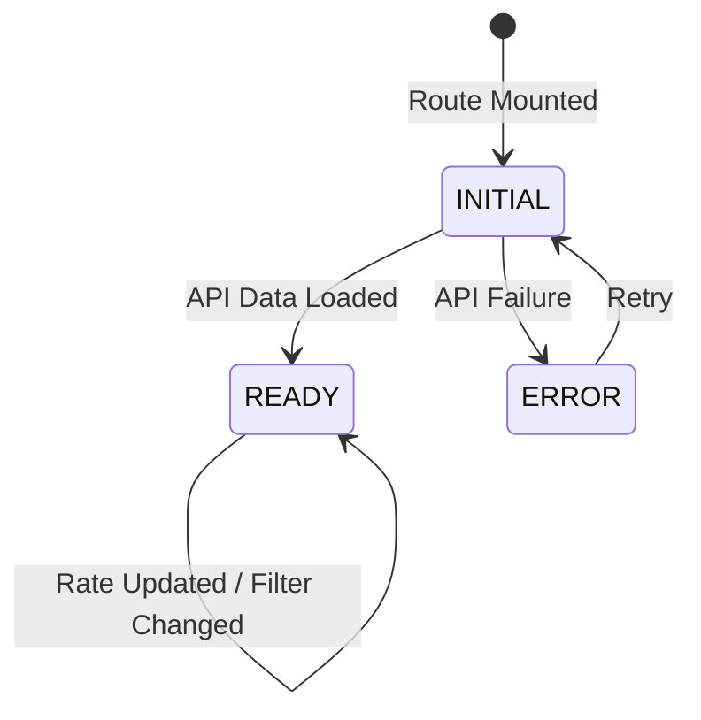
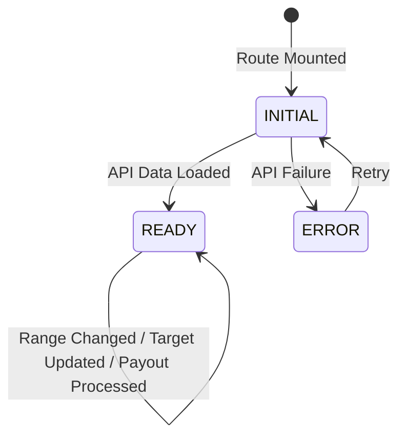

# DD_COMM_01 — Module Overview

> **Doc ID:** SKM-DD-COMM-01 | **Version:** 2.1 | **Status:** Released  
> **Last Updated:** 2026-10-15 (aligned to implementation)

---

## 1. Module Overview

The **Commission & Revenue Module** (手数料・収益管理モジュール) provides platform administrators with the tools required to manage commission settings, monitor revenue performance, review merchant commission reports, and manage merchant payouts. The module ensures financial transparency and enables administrative control over platform fees, payouts, and revenue trends.

This module encompasses commission rate configuration (with rate history), merchant-level commission report generation, revenue dashboard KPI visualization, advertisement fee revenue tracking, payout status breakdown, merchant payout management (review / process / delete), revenue target progress monitoring, revenue forecasting (linear regression), and financial report export (CSV/Excel).

---

## 2. Supported Use Cases

| ID | Use Case | Description |
|---|----------|-------------|
| UC-COMM-001 | View Commission Dashboard | Admin navigates to `/admin/commission-revenue` Tab 1 (Commission) to see the current commission rate and report data. |
| UC-COMM-002 | Edit Commission Rate | Admin updates the platform commission rate applied to new transactions. Rate is decimal 0 < rate ≤ 100, max 2dp (stored default 12.00). A history row is written so past reports keep their effective rates. |
| UC-COMM-003 | Filter Commission Reports | Admin filters merchant commission reports by date range (`from`/`to`) and grouping (merchant/day/order) with pagination. |
| UC-COMM-004 | View Revenue Dashboard | Admin navigates to Tab 2 (Revenue) to view KPI cards, trend chart, target progress, payment status panels, ad fee summary, and payout list. |
| UC-COMM-005 | Review Payout | Admin opens a pending payout's detail view (or cancels the process dialog) → status moves `pending` → `processing`; audit `PAYOUT_REVIEWED` written. |
| UC-COMM-006 | Process Payout | Admin processes a `pending`/`processing` payout → `completed` with `idempotencyKey`; concurrent repeats resolve via conditional update. Commission deduction only; ad fees excluded. |
| UC-COMM-007 | Delete Payouts | Admin selects payout rows and deletes them; only `completed` payouts at least 3 months old are eligible (409 otherwise). |
| UC-COMM-008 | Change Revenue Range | Admin selects `7d`/`30d`/`90d`/`1y` to refresh trend chart, forecast, and status panels. |
| UC-COMM-009 | Set Revenue Target | Admin configures a monthly or quarterly revenue target amount. One active target per period; saving overwrites. |
| UC-COMM-010 | View Target Progress | Admin views progress bar toward the configured revenue target (completed orders only, from period start). |
| UC-COMM-011 | View Revenue Forecast | Admin views the forecast (linear regression over ≥7 populated buckets) as a dotted line on the trend chart; empty series + note when insufficient data. |
| UC-COMM-012 | View Ad Fee Revenue | Admin views ad fee KPIs, trend series, and payment status breakdown (completed/pending/refunded). |
| UC-COMM-013 | Export Commission Report | Admin exports commission report rows as CSV or Excel with a date range (≤ 365 days) and grouping. |
| UC-COMM-014 | Export Revenue Report | Admin exports revenue KPI/trend data as CSV or Excel with a date range. |
| UC-COMM-015 | Export Payout History | Admin exports payout records as CSV or Excel, optionally for a single merchant. |

---

## 3. State Machines

### 3.1 Commission Page States

### 3.2 Revenue Page States

### 3.3 Payout State Transitions (as implemented)

| Transition | Origin | Target | Trigger | Guard |
|------------|--------|--------|---------|-------|
| TR-01 | `pending` | `processing` | `POST /payouts/:id/review` (detail view open, or process dialog cancel) | conditional update `WHERE status='pending'`; otherwise HTTP 200 unchanged (no error, no audit) |
| TR-02 | `pending` / `processing` | `completed` | `POST /payouts/:id/process` | not `completed` (409) / not `failed` (400); conditional update + unique `idempotencyKey` |
| TR-03 | `completed` | (deleted) | `DELETE /payouts` | `status='completed'` AND `createdAt ≤ now − 3 months`, else 409 |

> `failed` exists only in the DB comment, the frontend union type, and badge maps — no API writer, transition, or filter supports it. There is no `PAYOUT_FAILED` audit event.

### 3.4 Revenue Target State

| Transition | Trigger | Guard |
|------------|---------|-------|
| none → `active` | `PUT /admin/revenue/targets` (create) | amount > 0, period `monthly`/`quarterly` |
| `active` → `active` (overwrite) | same endpoint (update of the period's active row) | same |

> There is no delete/clear-target endpoint.

---

## 4. Security & Permissions

1. **Authentication**: JWT access token via `Authorization` header. All endpoints are admin-only.
2. **RBAC**: Backend enforced via `@UseGuards(JwtAuthGuard, RolesGuard)` + `@Roles('admin')`. Frontend route protection uses `roles={['admin', 'super_admin']}`.
3. **Audit Logging**: Rate updates, target saves, payout review/process/delete, and exports are logged with admin identity, old/new values, IP, and timestamp. Retention: 2 years (rate/target/payout), 1 year (export).
4. **Idempotency**: Payout processing is idempotent via conditional update + unique `idempotency_key` (`payout-<id>`); a repeat call on a completed payout returns `409`.
5. **Currency Precision**: All monetary values transmitted and rendered as strings to preserve decimal precision.
6. **Error Envelope**: Errors return `{statusCode, error, errorCode, message (string|string[]), timestamp, path, details?}`; codes are the global set (`VAL_001`, `AUTH_001`, `RES_004`, `RES_001`, `RES_003`, `RATE_001`, `SYS_001`). Module-specific `COMM_*`/`EXP_*` codes do not exist.
7. **Rate Limiting**: Global header-only `RateLimitInterceptor` (100 req/15 min per IP+route; never rejects; `RateLimit` response headers only).
8. **PII Exposure**: No PII in client logs.
9. **Export Security**: Exports select whitelisted columns only (no password hashes/tokens); all export actions are logged to `audit_logs`.

| Role | Can View Commission | Can Edit Rate | Can Process Payout | Can Export |
|------|:-------------------:|:-------------:|:------------------:|:----------:|
| `admin` | ✓ | ✓ | ✓ | ✓ |
| `super_admin` | ✓ | ✓ | ✓ | ✓ |
| `buyer` | ✗ | ✗ | ✗ | ✗ |
| `merchant` | ✗ | ✗ | ✗ | ✗ |

---

## 5. Architectural Components Involved

### 5.1 Frontend (`frontend/src/`)

| Layer | Files |
|-------|-------|
| Page | `pages/admin/CommissionRevenue.tsx` (two tabs; route `/admin/commission-revenue`) |
| Feature components | `features/admin/commission-revenue/components/`: `CommissionTable.tsx`, `CommissionReportsTable.tsx`, `ReportFilterPanel.tsx`, `ExportDialog.tsx`, `RevenueTab.tsx`, `RevenueKPICards.tsx`, `RevenueTrendChart.tsx`, `RangeToggle.tsx`, `RevenueTargetCard.tsx`, `EditTargetDialog.tsx`, `PaymentStatusPanel.tsx`, `AdPaymentStatusPanel.tsx`, `AdFeeSummaryCard.tsx`, `PayoutTable.tsx`, `PayoutConfirmationDialog.tsx`, `PayoutDetailDialog.tsx`, `badges.tsx` (plus stale `PaymentStatusPanel.tsx.bak`) |
| Hooks | `features/admin/commission-revenue/hooks/useCommission.ts`, `useRevenue.ts` |
| Service | `features/admin/commission-revenue/services/commission.service.ts` (all API calls) |
| Utils | `features/admin/commission-revenue/utils/format.ts` |
| i18n | `public/locales/{en,ja,my}/translation.json` — `admin.commission.*` (139 keys, synced); `skin` namespace bundled in `src/i18n.ts` |
| Shared | `@/components/PaginationControls`, `@/components/ui/*`, `@/lib/api` (axios instance) |

### 5.2 Backend (`backend/src/modules/admin/commission-revenue/`)

| Layer | Files |
|-------|-------|
| Controllers | `admin-commission.controller.ts`, `admin-revenue.controller.ts` |
| Services | `commission.service.ts`, `revenue.service.ts` (incl. payout review/process/delete), `forecast.service.ts`, `export.service.ts` |
| Helpers | `commission-revenue.util.ts` (fmtDecimal, bucketing), `file-builder.ts` (CSV/XLSX) |
| DTOs (9) | `dto/update-commission-rate.dto.ts`, `commission-report-query.dto.ts`, `save-revenue-target.dto.ts`, `revenue-target-query.dto.ts`, `revenue-trend-query.dto.ts`, `revenue-forecast-query.dto.ts`, `payout-query.dto.ts`, `delete-payouts.dto.ts`, `export-request.dto.ts` |
| Guards | `jwt-auth.guard.ts`, `roles.guard.ts` (+ global `AllExceptionsFilter`, `TransformInterceptor`, `RateLimitInterceptor`) |
| Prisma | `prisma/prisma.schema` |

---

## 6. API Endpoints

All under prefix `api/v1`, admin-only.

| Method | Endpoint | Description |
|--------|----------|-------------|
| `GET` | `/admin/commission` | Fetch current commission rate (settings row) |
| `PATCH` | `/admin/commission` | Update commission rate (+ history row + audit) |
| `GET` | `/admin/commission/reports` | Commission report rows (groupBy merchant/day/order, paginated) |
| `GET` | `/admin/revenue/kpis` | 6 revenue KPIs for range |
| `GET` | `/admin/revenue/trends` | Revenue/commission/ad-fee trend series |
| `GET` | `/admin/revenue/forecast` | Forecast series (or note when < 7 buckets) |
| `GET` | `/admin/revenue/target` | Active target + progress for period |
| `PUT` | `/admin/revenue/targets` | Save/overwrite target |
| `GET` | `/admin/revenue/payments/status` | Payout status counts for range (fetched, not rendered) |
| `GET` | `/admin/revenue/ad-fee` | Ad fee KPIs, trend, payment status |
| `GET` | `/admin/revenue/payouts` | Payout list (filters, pagination, statusCounts, periods) |
| `GET` | `/admin/revenue/payouts/merchants` | Distinct payout merchants |
| `POST` | `/admin/revenue/payouts/:id/review` | pending → processing |
| `POST` | `/admin/revenue/payouts/:id/process` | pending/processing → completed |
| `DELETE` | `/admin/revenue/payouts` | Delete eligible payouts (body `{payoutIds}`) |
| `POST` | `/admin/commission/export` | Export commission report (CSV/Excel) |
| `POST` | `/admin/revenue/export` | Export revenue report (CSV/Excel) |
| `POST` | `/admin/revenue/payouts/export` | Export payout report (CSV/Excel, optional merchant) |

---

## 7. Database Tables Involved

| Table | Purpose | Operations |
|-------|---------|------------|
| `commission_settings` | Current platform commission rate | SELECT, UPDATE |
| `commission_rate_history` | Rate change history (effective-rate lookups) | INSERT (on rate update), SELECT |
| `orders` | Order transactions | SELECT (reports, KPIs, trends, forecast) |
| `merchants` | Merchant info | SELECT (reports, payouts, merchant names) |
| `payouts` | Payout records with status | SELECT, UPDATE (review/process), DELETE |
| `payout_items` | Payout ↔ order line items | SELECT (detail aggregates, export) |
| `revenue_targets` | Monthly/quarterly revenue targets | SELECT, INSERT/UPDATE (active row per period) |
| `ad_payments` | Advertisement payment records | SELECT (ad fee KPIs/trends/status) |
| `advertisements` | Advertisement records | SELECT (active ads count) |
| `audit_logs` | Audit trail | INSERT (all module events) |

---

## 8. External Dependencies

| Dependency | Purpose | Configuration |
|------------|---------|---------------|
| Prisma ORM | Database access layer | `DATABASE_URL` |
| `class-validator` / `class-transformer` | DTO validation (global `ValidationPipe`) | — |
| `exceljs` | XLSX export generation | via `file-builder.ts` |
| i18next + react-i18next | Internationalization (EN/JA/MY) | `frontend/src/i18n.ts`, `public/locales/*/translation.json` |
| TanStack Query | Frontend data fetching/caching | — |
| Inline SVG | Trend/forecast chart (no chart library) | `RevenueTrendChart.tsx` |

---

## 9. Cross-References

| Related Document | Purpose |
|-----------------|---------|
| [DD_COMM_02](./DD_Commission_Revenue_02_FRONTEND_Page.md) | Frontend page design (v2.1) |
| [DD_COMM_03](./DD_Commission_Revenue_03_API_ENDPOINTS.md) | Backend REST API contract (v2.1) |
| [DD_COMM_04](./DD_Commission_Revenue_04_DTOS_AND_TYPES.md) | DTO and type definitions (v2.1) |
| [DD_COMM_05](./DD_Commission_Revenue_05_BUSINESS_LOGIC.md) | Backend business rules and payout lifecycle (v2.1) |
| [DD_COMM_06](./DD_Commission_Revenue_06_TEST_SPEC.md) | Test specification |
| [機能設計書_Commission_&_Revenue](../機能設計書_Commission_&_Revenue.md) | Full functional specification (v8.1) |
| [画面項目設計書_Commission_&_Revenue](../画面項目設計書_Commission_&_Revenue.md) | Screen items specification (v5.1) |
