# DD_SEARCH_01 — Module Overview

> **Doc ID:** SKM-DD-SEARCH-01 | **Version:** 1.3 | **Status:** Released  
> **Last Updated:** 2026-10-15

> **Codebase alignment:** This document is aligned with the implemented Search & Filter codebase
> (`frontend/src/pages/buyer/Products.tsx`, `frontend/src/features/search/**`,
> `frontend/src/schemas/search.schema.ts`, `backend/src/modules/catalog/search/**`) as of 2026-10-15.

---

## 1. Module Overview

The **Search & Filter Module** (検索・フィルタモジュール) is the product discovery and exploration subsystem within the Cosmetics Finder platform. It provides the complete set of capabilities necessary for all users (Visitor, Buyer, Merchant, Admin — REQUIREMENT_SPEC §2.2) to locate skincare products by keyword search, navigate the hierarchical category tree, apply multi-dimensional filters (skin type, ingredients, price range, minimum rating), sort results, and paginate through the catalog. The search results page also hosts the sponsored advertisement placement with the `search_page_banner` placement value (REQUIREMENT_SPEC §5.3). All search state is persisted in URL query parameters as the single source of truth, ensuring results are shareable, bookmarkable, and back-button friendly. Performance is maintained through Redis cache-aside patterns on the backend (product list TTL 2 min, category tree TTL 30 min) and TanStack Query client-side caching.

**Page layout flow:** A → B → Advertisement → C+D — The page header ([A]) renders at the top, followed by the full-width search bar ([B]), then the sponsored ad slide panel, then the active filter chips and the filters panel ([C]) + results area ([D]). On desktop, [C] and [D] are side-by-side; on mobile, [C] is presented as a slide-in drawer. On page load, the Ad API and Product Search API start in parallel and are non-blocking: the ad panel may slide in when ready, while product search renders independently and is never delayed by ad loading.

---

## 2. Supported Use Cases

| ID | Use Case | Description |
|---|----------|-------------|
| UC-SEARCH-001 | Search Products by Keyword | Users (all roles) search products by keyword with partial (case-insensitive) matching on name, short description, tags, and ingredients. |
| UC-SEARCH-002 | Browse Products by Category | Users navigate the flattened category list (built from the nested tree) and filter by a category including all descendant categories. |
| UC-SEARCH-003 | Filter by Skin Type | Users filter results to products compatible with one or more selected skin types (multi-select, `hasEvery` semantics). |
| UC-SEARCH-004 | Filter by Ingredients | Users filter results to products containing any of the selected ingredients (multi-select, `hasSome` semantics). |
| UC-SEARCH-005 | Filter by Price Range | Users filter results to products within min/max price bounds. |
| UC-SEARCH-006 | Filter by Minimum Rating | Users filter results to products with `avg_rating >= selected rating` (options 3.0+ / 3.5+ / 4.0+ / 4.5+). |
| UC-SEARCH-007 | Sort Results | Users sort by newest, price (low-to-high or high-to-low), or highest rating. |
| UC-SEARCH-008 | Paginate Results | Users page through results with a configurable page size (12, 24, or 48 items; default 12; max 100). |
| UC-SEARCH-009 | View Product Detail from Results | User clicks a product card and navigates to `/buyer/products/:slug`. |
| UC-SEARCH-010 | View Sponsored Advertisements | Approved, in-schedule ads rendered in a slide panel below the search bar via `GET /api/v1/search/ads?placement=search_page_banner` (REQUIREMENT_SPEC §5.3). |
| UC-SEARCH-011 | Toggle View Mode | Users switch result layout between Grid (responsive 1–3 columns) and List (single-column stacked rows). Selection persists to `localStorage` key `search.viewMode`, defaults to Grid, and does not affect URL state. |
| UC-CATEGORY-001 | Load Category Tree | Nested category tree fetched from Redis/DB and rendered as a collapsible list in the filter panel sidebar or mobile drawer. |

---

## 3. Query Lifecycle State Machine

The Search & Filter module manages the UI state lifecycle from page load through query execution, result rendering, and error handling.

```mermaid
stateDiagram-v2
    [*] --> IDLE : Page Load (default catalog)

    IDLE --> LOADING : Keyword (after 300ms debounce) / Filter / Sort / Page change
    LOADING --> SUCCESS : Fetch resolves 200
    LOADING --> EMPTY : Fetch resolves total = 0
    LOADING --> ERROR : Fetch rejects (network/4xx/5xx)

    SUCCESS --> LOADING : Filter / Sort / Page changed
    SUCCESS --> IDLE : Clear all filters + keyword

    EMPTY --> LOADING : Filters reset / new keyword
    EMPTY --> IDLE : Clear all filters + keyword

    ERROR --> LOADING : URL state changed (retry)
    ERROR --> IDLE : Clear all filters + keyword

    LOADING --> LOADING : URL state changed (cancel/overwrite prior query; latest request only)
```



**Query Lifecycle States:**

| State | Description | Results Displayed | Actions Available |
|-------|-------------|:-----------------:|-------------------|
| `IDLE` | Page loaded, no query in-flight | ✓ (default catalog) | Search, filter, sort, paginate |
| `LOADING` | Query in-flight | Centered spinner | New query (replaces in-flight) |
| `SUCCESS` | Query returned successfully | ✓ | Sort, filter, paginate, view detail |
| `EMPTY` | Query returned zero matches | Empty state (no action button) | Clear all filters, broaden keyword |
| `ERROR` | Query failed (network/4xx/5xx) | Inline error state | Change URL state to retry |

---

## 4. URL-State Architecture & Request Lifecycle

1. **URL as Single Source of Truth**: All search state (`q`, `categoryId`, `skinTypes`, `ingredients`, `tags`, `minPrice`, `maxPrice`, `rating`, `sort`, `order`, `page`, `limit`) is persisted in URL query parameters (BR-SEARCH-003). Never React Context.
2. **Separate URL-State Lifecycle**: URL search-state parsing, validation, serialization, and history updates are managed separately from product request execution. Each canonical URL-state snapshot produces one product query; unrelated UI state must not trigger a search.
3. **Latest State Wins**: When the canonical URL search state changes, the previous in-flight product request is aborted via the query `AbortSignal`, and the latest request starts. Only the latest result may update the UI (ST-DEB-004).
4. **Parallel Ad and Product Requests**: The Ad API (`GET /api/v1/search/ads?placement=search_page_banner`) and Product Search API start independently and in parallel. Ad loading, failure, or an empty response must never block, cancel, defer, or replace product search. The ad panel hides on failure or when no eligible ad exists (a built-in set of fallback ads is shown when the API returns no eligible ads without error).
5. **Public Endpoints**: Search, category browsing, product detail, and sponsored ads require no authentication — fully open to visitors and authenticated users alike.
6. **Visibility Rules**: Only `products.is_active = true` products from merchants with `merchants.license_status = 'approved'` are surfaced (BR-SEARCH-012, BR-SEARCH-013). Out-of-stock products remain listed but flagged `isInStock: false` (BR-SEARCH-014).
7. **Debounce**: Keyword input fires after 300ms of typing inactivity (ST-DEB-001). Search button / Enter and filter changes fire immediately (ST-DEB-003).
8. **Cache-Aside Pattern**: Redis checked first → miss → query DB → seed Redis. List cache key is `cache:products:list:v2:{md5}` of the serialized query params; category tree cache key is `cache:categories`. Ads are queried directly (not cached by the search service). Always set TTL; never cache sensitive data (BR-SEARCH-005).
9. **Page Reset on Change**: Any filter or sort change resets `page` to 1 (BR-SEARCH-011).
10. **Price Validation Gate**: When the price range is invalid (`min > max` or negative), the page blocks URL/query updates and cancels the in-flight product query until corrected.
11. **Data Isolation**: Unapproved merchant products are excluded at the query level (REQUIREMENT_SPEC §2.4, DEV §12.2). SQL injection prevented via Prisma parameterized queries.
12. **View Mode Toggle**: Grid/List toggle persists to `localStorage` (`search.viewMode`), defaults to Grid, and is never written to URL params — search/filter/sort/page state is unaffected. Switching views re-renders already-fetched data — no API refetch triggered.
13. **Sponsored Ad Panel**: The ad slider renders below the full-width search bar, above the filter chips and the filters/results row, spanning the full container width.

---

## 5. Page Layout Flow

```
┌──────────────────────────────────────────────────────────┐
│ [A] PAGE HEADER / TITLE                                  │
│     Logo + System Name                                   │
├──────────────────────────────────────────────────────────┤
│ [B] SEARCH BAR (full width)                              │
│     [B1] Keyword Input   [B2] Search Button              │
│     [B3] Clear (×, shown when input non-empty)           │
├──────────────────────────────────────────────────────────┤
│ [D0] SPONSORED AD SLIDE PANEL (conditional)              │
│     Full container width, auto-sliding banner            │
├──────────────────────────────────────────────────────────┤
│ [D3] ACTIVE FILTER CHIPS (+ "Clear All")                 │
├──────────────────────────────────────────────────────────┤
│ ┌────────────────────┐  ┌──────────────────────────────┐ │
│ │ [C] FILTERS PANEL  │  │ [D] RESULTS AREA             │ │
│ │ [C1] Categories    │  │ [D1] Sort Select [D2] View   │ │
│ │ [C2] Skin Type     │  │ [D3] Product Grid / List     │ │
│ │ [C3] Price Range   │  │ [D4] Pagination              │ │
│ │ [C4] Rating        │  │                              │ │
│ │ [C5] Clear All     │  │                              │ │
│ └────────────────────┘  └──────────────────────────────┘ │
├──────────────────────────────────────────────────────────┤
│ [E] FOOTER CONTROLS — [Language] [Theme]                 │
└──────────────────────────────────────────────────────────┘
```

On mobile (< 1024px) the filters sidebar ([C]) is hidden and replaced by a "Filters" trigger button that opens a right-side sheet (drawer) containing the same filter groups plus "Clear All" and "Show N Products" actions.

---

## 6. Architectural Components Involved

| Layer | Files |
|-------|-------|
| **Frontend Page** | `frontend/src/pages/buyer/Products.tsx` (exported as `Products`; lazily mounted as `BuyerSearchFilter` at `/products`, `/buyer/products`, `/buyer/search`) |
| **Frontend Components** | `SearchBar.tsx`, `FilterPanel.tsx`, `CategorySelect.tsx`, `FilterChips.tsx`, `SortSelect.tsx`, `ViewToggle.tsx`, `ProductCard.tsx`, `SponsoredAdSlider.tsx`, `StarRating.tsx` |
| **Frontend Hooks** | `useProductSearch.ts` (URL state + TanStack Query), `useCategoryTree.ts`, `useSponsoredAds.ts`, `useAdProducts.ts` |
| **Frontend Services** | `product.service.ts`, `category.service.ts`, `ad.service.ts` |
| **Frontend Schemas** | `frontend/src/schemas/search.schema.ts` (Zod — URL query param parsing/validation, `SORT_OPTIONS`, `PAGE_SIZE_OPTIONS`) |
| **Backend Controller** | `backend/src/modules/catalog/search/search.controller.ts` (`@Controller('search')`) |
| **Backend Service** | `backend/src/modules/catalog/search/search.service.ts` |
| **Backend DTOs** | `dto/product-query.dto.ts` (query params), `dto/ads-query.dto.ts`, `dto/product-slug-param.dto.ts`, `dto/product-summary.dto.ts`, `dto/category-node.dto.ts`, `dto/product-detail.dto.ts`, `dto/sponsored-ad.dto.ts` |
| **Backend Caching** | `shared/redis/redis.service.ts` (cache-aside for product lists and category tree) |
| **Shared Services** | `shared/prisma/prisma.service.ts` (`products`, `categories`, `merchants`, `shops`, `advertisements`, `ad_fee_settings` tables) |

---

## 7. API Endpoints

| Method | Endpoint | Description | Auth Required |
|--------|----------|-------------|:-------------:|
| `GET` | `/api/v1/search/products` | Search/filter/sort/paginate the product catalog | No |
| `GET` | `/api/v1/search/categories` | Fetch the nested category tree for navigation | No |
| `GET` | `/api/v1/search/products/:slug` | Fetch full product detail by slug (from result click) | No |
| `GET` | `/api/v1/search/ads?placement=search_page_banner` | Sponsored ads for the search page banner placement (approved & active only) | No |
| `GET` | `/api/v1/products/:idOrSlug` | Buyer product detail by id or slug (used to hydrate ad SKU products) | No |

---

## 8. Database Tables Involved

| Table | Purpose | Operations |
|-------|---------|------------|
| `products` | Store product data, pricing, stock, rating, skin types, ingredients, tags | SELECT (search, count, detail), filtered by `is_active` |
| `categories` | Store hierarchical category tree (self-referencing `parent_id`) | SELECT (tree build, recursive descendant lookup) |
| `merchants` | Store merchant account info and license approval status | SELECT (relation filter: `license_status = 'approved'`) |
| `shops` | Store merchant shop info and approval status | SELECT (ad relation filter: `is_approved = true`) |
| `reviews` | Store product reviews; `avg_rating` and `review_count` maintained as aggregates | SELECT (via `products.avg_rating`, `products.review_count`) |
| `advertisements` | Store sponsored ad content, schedule, and approval status | SELECT (by placement via `fee_setting`, `approval_status`, schedule) |
| `ad_fee_settings` | Store placement/tier fee & duration configuration | SELECT (placement join for placement filtering) |

---

## 9. External Dependencies

| Dependency | Purpose | Configuration |
|------------|---------|---------------|
| Redis | Product list cache (`cache:products:list:v2:{hash}`, TTL 120s) and category tree cache (`cache:categories`, TTL 1800s) | `REDIS_URL` |
| PostgreSQL | Source of truth for products, categories, merchants, shops, reviews, advertisements | `DATABASE_URL` |
| TanStack Query | Client-side query caching, deduplication, `placeholderData` (keepPreviousData) on pagination | Frontend config |

> Advertisements are **not** cached by `SearchService`; each request queries the database. The category tree is cached for 1800s and product lists for 120s.

---

## 10. Cross-References

| Related Document | Purpose |
|-----------------|---------|
| [DD_SEARCH_02](./DD_Search_And_Filter_02_FRONTEND_Page.md) | Frontend page design |
| [DD_SEARCH_03](./DD_Search_And_Filter_03_API_ENDPOINTS.md) | Backend REST API contract |
| [DD_SEARCH_04](./DD_Search_And_Filter_04_DTOS_AND_TYPES.md) | DTO and type definitions |
| [DD_SEARCH_05](./DD_Search_And_Filter_05_BUSINESS_LOGIC.md) | Backend business rules, caching, and query building |
| [DD_SEARCH_06](./DD_Search_And_Filter_06_TEST_SPEC.md) | Test specification (synced to PCL scenario IDs) |
| [SearchAndFilter_PCL](../SearchAndFilter_PCL.md) | Program checklist (scenario IDs N / A / B / I) |
| [機能設計書_Search_And_Filter](../機能設計書%20_Search_And_Filter.md) | Full functional specification (v2.3) |
| [画面項目設計書_Search_And_Filter](../画面項目設計書_Search_And_Filter.md) | Screen items specification (v2.6) |
