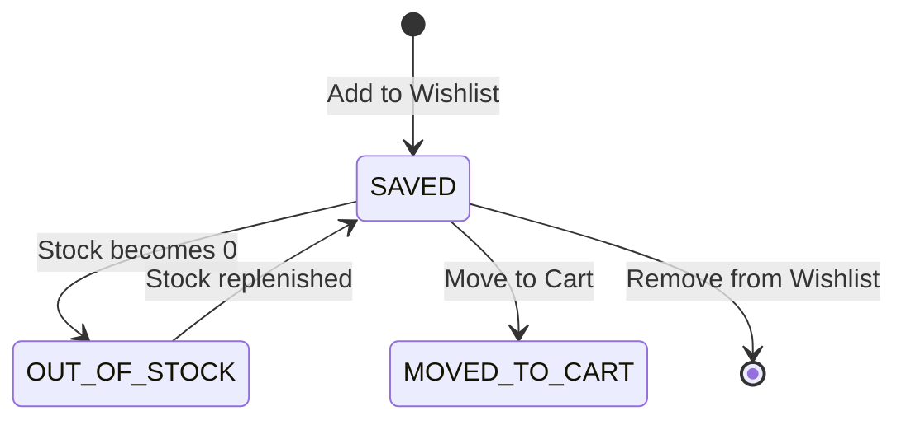
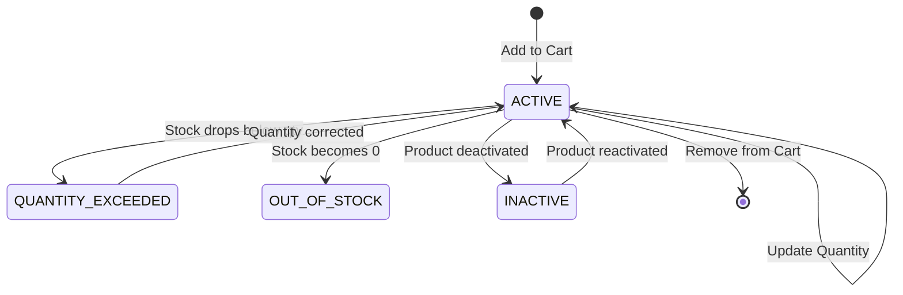

# DD_WISH-CART_01 — Module Overview

> **Doc ID:** SKM-DD-WISH-CART-01 | **Version:** 1.3 | **Status:** Released  
> **Last Updated:** 2026-10-15

---

## 0. Document Revision History

| Version | Date | Description of Changes |
|---------|------|------------------------|
| 1.0 | 2026-08-14 | Initial module overview. |
| 1.1 | 2026-08-18 | Added clear-all endpoints and architectural components (DTOs, schemas, shared dialogs). |
| 1.2 | 2026-08-21 | Aligned wishlist table name with DATABASE_SPEC (`wishlist`); refreshed cross-references. |
| 1.3 | 2026-10-15 | Reconciled with the current implementation and 機能設計書 v2.2 / 画面項目設計書 v2.2: added Clear-All use cases and endpoints (`DELETE /wishlist`, `DELETE /cart/items`), Proceed-to-Checkout use case with the deactivated-account guard, corrected frontend component/hook/service file paths, documented duplicate-cart (409) handling on Move-to-Cart, guest gating per entry point, and the `canCheckout` semantics (computed by the backend, not used by the Cart UI). |

---

## 1. Module Overview

The **Wishlist & Cart Module** (お気に入り & カートモジュール) is the core e-commerce workflow component for the Cosmetics Finder platform. It manages product curation through wishlists, shopping cart operations, stock validation, and price calculation to support a seamless purchasing experience. This module bridges product browsing and order placement, ensuring authenticated users can save products, manage quantities, validate stock availability, and proceed to checkout.

The Wishlist subsystem enables users to save products for future reference, while the Cart subsystem manages the complete purchase workflow from product selection through checkout initiation. Both subsystems enforce strict ownership rules and stock validation to maintain data integrity and prevent inventory issues.

Both pages are **buyer-only** protected routes (`/buyer/wishlist`, `/buyer/cart`). Guests are redirected to `/login` on direct navigation; guest actions triggered from the header or listing/search/recommendation surfaces open login dialogs at those entry points instead.

---

## 2. Supported Use Cases

| ID | Use Case | Description |
|---|----------|-------------|
| UC-WISH-001 | Add Product to Wishlist | Authenticated buyer saves a product to their wishlist (`POST /wishlist/:productId`). A duplicate returns `409` and shows the "Already in Wishlist" dialog on the product-detail surface. |
| UC-WISH-002 | Remove Product from Wishlist | Authenticated buyer removes a saved product from the wishlist page (trash button) or via the toggle action on listing/search/recommendation cards. |
| UC-WISH-003 | View Wishlist | Authenticated buyer views saved products with images, category, and prices. Out-of-stock items are shown with the Add button disabled (no stock badge on wishlist cards). |
| UC-WISH-004 | Move Wishlist Item to Cart | Authenticated buyer transfers an in-stock wishlist item into the cart (`quantity = 1`). If the product is already in the cart, the API returns `409 Conflict` and the `DuplicateCartAlertDialog` is shown; quantities are never merged and the wishlist item is retained. |
| UC-WISH-005 | Guest User Wishlist Attempt | Guests are redirected to `/login` when navigating directly to the wishlist route; header/listing actions open a login dialog; the product-detail Add to Wishlist button is disabled for guests and non-buyers. |
| UC-WISH-006 | Clear Wishlist | Authenticated buyer deletes all wishlist items at once via "All Data Clear" with a `ConfirmDialog`; calls `DELETE /wishlist` and receives `{ success, deletedCount }`. |
| UC-CART-001 | Add Product to Cart | Authenticated buyer adds an in-stock product to their cart (`POST /cart/items`, default quantity 1). A duplicate returns `409` and shows the "Already in Cart" dialog. |
| UC-CART-002 | Update Cart Item Quantity | Authenticated buyer modifies the quantity of a cart item (`PATCH /cart/items/:id`) with server-side stock validation (1–99; must not exceed stock). |
| UC-CART-003 | Remove Item from Cart | Authenticated buyer removes an item from their cart (`DELETE /cart/items/:id`). |
| UC-CART-004 | View Cart | Authenticated buyer views cart items with images, names, unit prices, quantities, subtotals, stock badges, and the summary panel (subtotal, shipping estimate, total). |
| UC-CART-005 | Guest User Add to Cart Attempt | Guests are redirected to `/login` when navigating directly to the cart route; header/listing actions open a login dialog; the product-detail Add to Cart action navigates directly to `/login?redirect=/buyer/products`. |
| UC-CART-006 | Clear Cart | Authenticated buyer deletes all cart items at once via "All Data Clear" with a `ConfirmDialog`; calls `DELETE /cart/items` and receives `{ success, deletedCount }`. |
| UC-CART-007 | Proceed to Checkout | Authenticated buyer navigates to `/buyer/checkout` from the cart summary. If the account is deactivated (`isAccountDeactivated(user)`), the `AccountDeactivatedDialog` is shown instead and navigation is blocked. |

---

## 3. State Transition Specification

The Wishlist & Cart module manages two primary state machines: Wishlist Item States and Cart Item States.

### 3.1 Wishlist Item States

| State | Description | Visible in Wishlist | Can Move to Cart |
|-------|-------------|:-------------------:|:----------------:|
| `SAVED` | Product saved in wishlist, in stock (`isInStock` true) | ✓ | ✓ |
| `OUT_OF_STOCK` | Product saved but currently out of stock (`isInStock` false) | ✓ (Add button disabled; no stock badge) | ✗ |
| `INACTIVE` | Not exposed as a UI state: the GET response omits `isActive` and the card renders no inactive notice. Move-to-Cart returns `404` for inactive products. | May still render while the product relation exists | ✗ |
| `MOVED_TO_CART` | Item transferred to cart; the wishlist record is always removed on success | ✗ | — |

### 3.2 Cart Item States

| State | Description | Visible in Cart | Can Checkout |
|-------|-------------|:---------------:|:------------:|
| `ACTIVE` | Item in cart with valid stock | ✓ | ✓ |
| `LOW_STOCK` | Item in cart, stock below threshold (≤10) | ✓ (warning) | ✓ |
| `OUT_OF_STOCK` | Item in cart, stock = 0 | ✓ (out-of-stock badge) | `canCheckout` is false; the checkout button is **not** disabled by this field |
| `QUANTITY_EXCEEDED` | Requested quantity exceeds available stock | ✓ (quantity controls disabled) | `canCheckout` is false; the checkout button is **not** disabled by this field |
| `INACTIVE` | Cart item's product is deactivated (`isAvailable` false); no dedicated notice rendered | ✓ | `canCheckout` is false; the checkout button is **not** disabled by this field |

> **Note on `canCheckout`:** The backend computes `canCheckout = true` only when the cart is non-empty and contains no out-of-stock, quantity-exceeded, or inactive items. The Cart UI neither displays nor uses this field to disable checkout. Checkout is blocked only by the client-side deactivated-account guard (BR-CART-013).

---

## 4. Security & Permissions

1. **Authentication Required**: All wishlist and cart endpoints require a valid JWT Bearer token via the `Authorization` header (`JwtAuthGuard`).
2. **Role-Based Access**: Only the `buyer` role can access wishlist and cart features (`@Roles('buyer')` + `RolesGuard` at controller level). Merchants and Admins receive `403 Forbidden`.
3. **Active Account Guard**: Write endpoints (`POST /wishlist/:productId`, `POST /wishlist/:productId/move-to-cart`, `POST /cart/items`) additionally apply `ActiveUserGuard` to reject deactivated accounts.
4. **Ownership Validation**: Users can only view/modify their own wishlist and cart items (filtered by `user_id` from the JWT); cart item operations resolve ownership through the user's `cart` row (IDOR prevention).
5. **Stock Validation**: Server-side stock checks prevent adding out-of-stock items; quantity updates are rejected when the requested quantity exceeds stock (1–99).
6. **Price Integrity**: Prices are fetched from the database, never client-provided.
7. **Duplicate Protection**: Unique constraints on `wishlist (user_id, product_id)` and `cart_items (cart_id, product_id)`; duplicates return `409 Conflict` and are never auto-merged.
8. **Guest Handling**: The `/buyer/wishlist` and `/buyer/cart` routes are wrapped in `ProtectedRoute roles={['buyer']}`, so direct guest navigation redirects to `/login`. Header wishlist/cart icons and listing/search/recommendation actions open login dialogs at their entry points; product-detail Add to Cart navigates to `/login?redirect=/buyer/products`; product-detail Add to Wishlist is disabled for guests and non-buyers.
9. **Deactivated Account at Checkout**: Even when backend guards pass, the cart page re-checks `isAccountDeactivated(user)` before navigating to checkout and opens `AccountDeactivatedDialog` instead.

---

## 5. Architectural Components Involved

Verified file paths under `frontend/src` and `backend/src`:

| Layer | Files |
|-------|-------|
| **Frontend Pages** | `pages/buyer/Wishlist.tsx`, `pages/buyer/Cart.tsx` |
| **Wishlist Feature** | `features/buyer/wishlist/components/WishlistItemCard.tsx`, `WishlistItem.tsx`, `WishlistGrid.tsx`; `features/buyer/wishlist/hooks/useWishlist.ts` (exports `wishlistKeys`, `useWishlist`); `features/buyer/wishlist/services/wishlist.service.ts` |
| **Cart Feature** | `features/buyer/cart/components/CartItemRow.tsx`, `CartItem.tsx`, `CartSummaryPanel.tsx`, `CartSummary.tsx`, `CartDrawer.tsx`; `features/buyer/cart/hooks/useCart.ts` (exports `cartKeys`, `useCart`); `features/buyer/cart/services/cart.service.ts` |
| **Shared Components** | `components/common/QuantityStepper.tsx`, `components/common/StockBadge.tsx`, `components/common/EmptyState.tsx` (variants `wishlist`/`cart`), `components/common/ConfirmDialog.tsx`, `components/common/DuplicateCartAlertDialog.tsx`, `components/common/GuestLoginModal.tsx` (rendered by `components/layout/Header.tsx`, not by these pages), `components/shared/AccountDeactivatedDialog.tsx` |
| **Types** | `types/wishlist-cart.types.ts` (`WishlistItem`, `CartItem`, `CartSummary`, `CartResponse`, `MoveToCartResponse`, `StockStatus`); no dedicated Zod schemas exist for this feature |
| **Backend API** | `modules/buyer/wishlist/wishlist.controller.ts`, `modules/buyer/cart/cart.controller.ts` |
| **Backend Service** | `modules/buyer/wishlist/wishlist.service.ts`, `modules/buyer/cart/cart.service.ts` |
| **Backend DTOs** | `modules/buyer/wishlist/dto/add-to-wishlist.dto.ts`, `wishlist-path.dto.ts`; `modules/buyer/cart/dto/add-to-cart.dto.ts`, `update-cart-quantity.dto.ts`, `cart-item-path.dto.ts`, `cart-summary-response.dto.ts` |
| **Backend Guards** | `common/guards/jwt-auth.guard.ts`, `common/guards/roles.guard.ts`, `common/guards/active-user.guard.ts` |
| **Backend Module Config** | `wishlist.module.ts`, `cart.module.ts` (providers: service + `ActiveUserGuard`; imports `PrismaModule`) |
| **Shared Services** | `shared/prisma/prisma.service.ts` (tables: `wishlist`, `carts`, `cart_items`, `products`) |

---

## 6. API Endpoints

All endpoints are prefixed with `/api/v1`, wrapped in the `{ data: ... }` envelope, and require `Authorization: Bearer <accessToken>`.

| Method | Endpoint | Description | Class Guards | Method Guards | Success |
|--------|----------|-------------|:------------:|:-------------:|:-------:|
| `GET` | `/api/v1/wishlist` | Get user's wishlist items (`{ items, totalCount }`) | JwtAuth + Roles(buyer) | — | 200 |
| `DELETE` | `/api/v1/wishlist` | Clear all wishlist items → `{ success, deletedCount }` | JwtAuth + Roles(buyer) | — | 200 |
| `POST` | `/api/v1/wishlist/:productId` | Add product to wishlist | JwtAuth + Roles(buyer) | ActiveUser | 201 (409 on duplicate) |
| `DELETE` | `/api/v1/wishlist/:productId` | Remove product from wishlist | JwtAuth + Roles(buyer) | — | 204 |
| `POST` | `/api/v1/wishlist/:productId/move-to-cart` | Move wishlist item to cart → `{ cartItem, wishlistRemoved }` | JwtAuth + Roles(buyer) | ActiveUser | 201 (409 "This product is already in cart.") |
| `GET` | `/api/v1/cart` | Get user's cart items with summary | JwtAuth + Roles(buyer) | — | 200 |
| `DELETE` | `/api/v1/cart/items` | Clear all cart items → `{ success, deletedCount }` | JwtAuth + Roles(buyer) | — | 200 |
| `POST` | `/api/v1/cart/items` | Add product to cart | JwtAuth + Roles(buyer) | ActiveUser | 201 (409 on duplicate) |
| `PATCH` | `/api/v1/cart/items/:id` | Update cart item quantity | JwtAuth + Roles(buyer) | — | 200 |
| `DELETE` | `/api/v1/cart/items/:id` | Remove item from cart | JwtAuth + Roles(buyer) | — | 204 |

**Frontend duplicate-cart detection on Move-to-Cart:** `Wishlist.tsx` matches the error **message string** `"This product is already in cart."` (not the HTTP status) to open `DuplicateCartAlertDialog`; other add-to-cart surfaces (product list, search, matching) check `response.status === 409`.

---

## 7. Database Tables Involved

| Table | Purpose | Operations |
|-------|---------|------------|
| `wishlist` | Store user's saved products (unique constraint: `user_id` + `product_id`) | INSERT (add), DELETE (remove / clear-all via `deleteMany` by `user_id`), SELECT (view) |
| `carts` | Store user's shopping cart (one cart per user) | SELECT (resolve), INSERT (upsert on move-to-cart / add) |
| `cart_items` | Store individual items within a cart (unique constraint: `cart_id` + `product_id`) | INSERT (add / move-to-cart), UPDATE (quantity), DELETE (remove / clear-all via `deleteMany` by `cart_id`), SELECT (view) |
| `products` | Product details, stock, pricing | SELECT (validation, display), UPDATE (stock decrement on order — handled by the Orders module) |
| `users` | User authentication, role, and active-status validation | SELECT (JWT validation, `ActiveUserGuard`) |

---

## 8. External Dependencies

| Dependency | Purpose | Configuration |
|------------|---------|---------------|
| Prisma ORM | Database operations (`PrismaModule` imported by both feature modules) | `DATABASE_URL` |
| JWT Library | Token verification for authentication | `JWT_ACCESS_SECRET` |
| Redis | Optional / not currently used by wishlist or cart services | `REDIS_URL` |

---

## 9. Cross-References

| Related Document | Purpose |
|-----------------|---------|
| [DD_WISH-CART_02](./DD_Wishlist_CartPage_02_FRONTEND_Page.md) | Frontend page design |
| [DD_WISH-CART_03](./DD_Wishlist_CartPage_03_API_ENDPOINTS.md) | Backend REST API contract |
| [DD_WISH-CART_04](./DD_Wishlist_CartPage_04_DTOS_AND_TYPES.md) | DTO and type definitions |
| [DD_WISH-CART_05](./DD_Wishlist_CartPage_05_BUSINESS_LOGIC.md) | Backend business rules and state transitions |
| [DD_WISH-CART_06](./DD_Wishlist_CartPage_06_TEST_SPEC.md) | Test specification |
| [機能設計書_Wishlist_CartPage](../機能設計書_Wishlist_CartPage.md) | Full functional specification (v2.2) |
| [画面項目設計書_Wishlist_CartPage](../画面項目設計書_Wishlist_CartPage.md) | Screen items specification (v2.3) |
